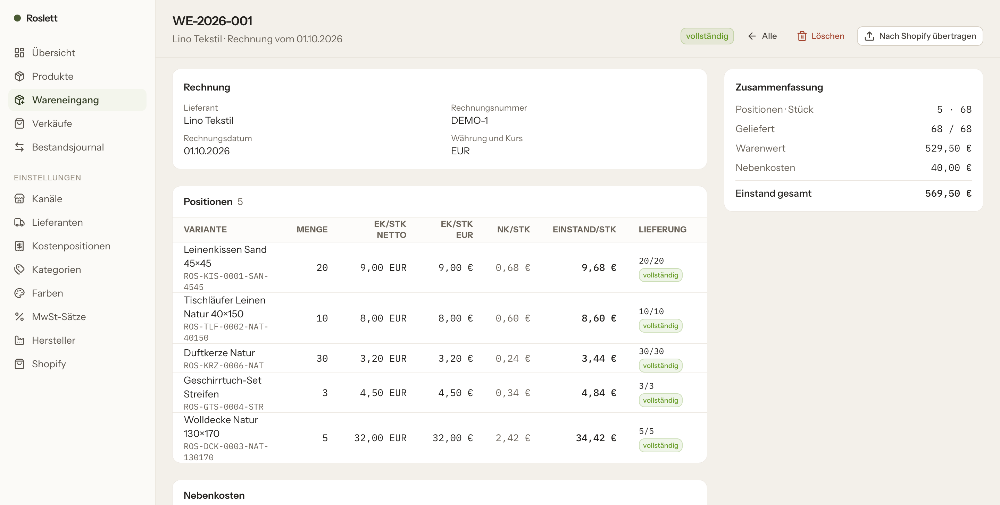
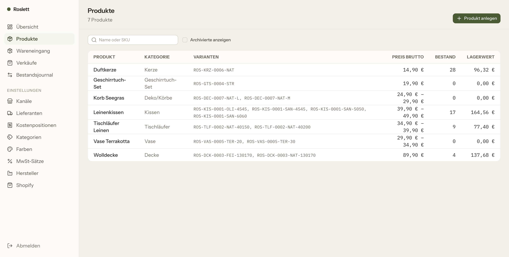
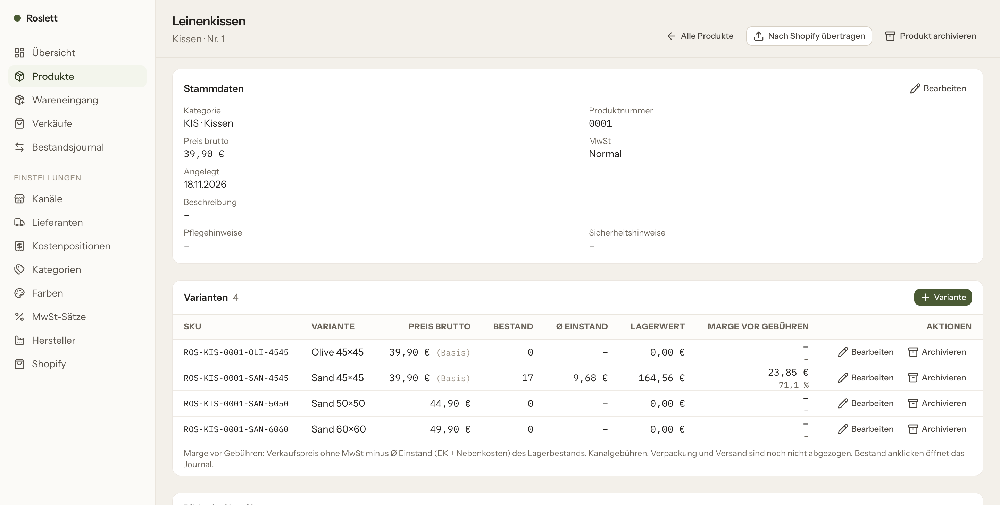
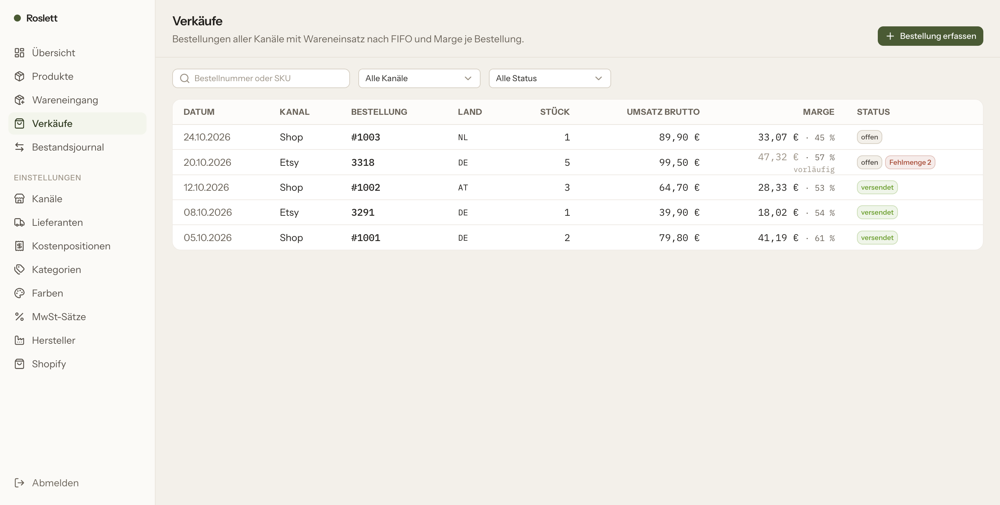
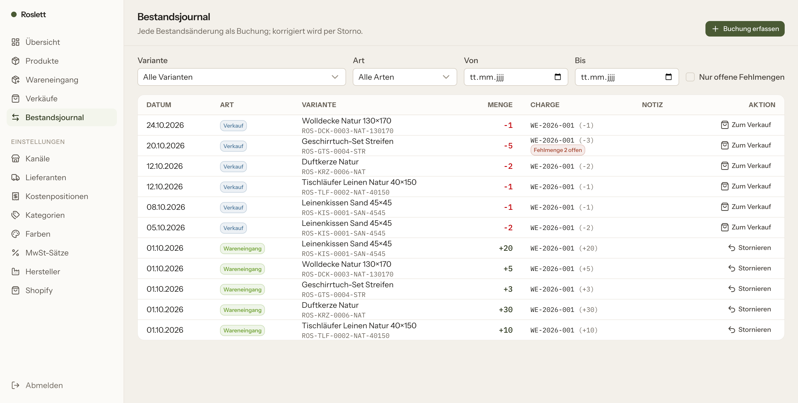

# Roslett-Dashboard

Warenwirtschaft und Kalkulation für Roslett, einen kleinen Onlineshop für
Heimtextilien. Das Dashboard verfolgt jeden Artikel vom Wareneingang über das
Lager bis zum Verkauf und rechnet den echten Einstandspreis und die Marge je
Bestellung aus. Der Shop selbst läuft auf Shopify.

> **English summary:** Inventory and margin tool for a small home-textile shop.
> Nuxt 4 / Vue 3 / TypeScript (strict), PostgreSQL with Drizzle, Zod at every
> boundary, FIFO stock valuation with landed costs, foreign currency at the ECB
> rate, two-way Shopify sync (orders in, products, prices and stock out).
> Framework-free calculation engine, 291 unit tests. The UI and the domain docs
> are in German, the code is in English.



## Wofür

Ein kleiner Shop kauft im Ausland ein, zahlt Fracht und Zoll oft erst Wochen
später und verkauft über mehrere Kanäle mit unterschiedlichen Gebühren. Ein
Tabellenblatt beantwortet dann die wichtigste Frage nicht mehr zuverlässig:
**Was verdiene ich an diesem Produkt wirklich?**

Das Dashboard beantwortet sie aus den Buchungen:

- **Einstand je Stück** aus Einkaufspreis, Fremdwährung zum EZB-Kurs und
  anteiligen Nebenkosten. Ein später eingehender Zollbescheid wirkt rückwirkend.
- **Lagerwert nach FIFO.** Der Bestand ist kein Feld, sondern ergibt sich aus dem
  Bestandsjournal. Korrigiert wird per Storno, nie durch Überschreiben.
- **Marge je Bestellung** mit Kanalgebühren, Porto und MwSt-Satz des Lieferlands.
- **Shopify-Anbindung:** Bestellungen und Erstattungen kommen automatisch herein,
  Produkte, Bilder, Preise und Bestandsänderungen gehen hinaus.

## Screenshots

| | |
|---|---|
|  |  |
| **Produkte** mit SKUs, Bestand und Lagerwert | **Produkt-Detail** mit Einstand und Marge je Variante |
|  |  |
| **Verkäufe** aller Kanäle mit Marge und Fehlmengen | **Bestandsjournal** mit Charge je Buchung |

Alle Zahlen sind Demodaten aus `npm run db:seed`.

## Technik

| Bereich | Umsetzung |
|---|---|
| Frontend | Nuxt 4, Vue 3 (Composition API), Nuxt UI, eigene Design-Tokens |
| Sprache | TypeScript strict in allen Paketen |
| Backend | Nitro-Server-Routes als REST-API |
| Datenbank | PostgreSQL 16, Drizzle ORM, geprüfte SQL-Migrationen |
| Validierung | Zod-Schemas, von Client und Server gemeinsam genutzt |
| Kalkulation | `packages/core`: reines TypeScript ohne Vue und Datenbank |
| Integration | Shopify Admin API (GraphQL), EZB-Referenzkurse |
| Zugang | Session-Login mit `nuxt-auth-utils`, Passwort als scrypt-Hash, Sperre nach Fehlversuchen |
| Tests | Vitest, 291 Tests |
| CI/CD | GitHub Actions (Lint, Typecheck, Tests, Build), Release-Workflow mit Changelog, Dependabot |
| Betrieb | Netlify (App, Scheduled Functions) und Neon (Postgres) |

### Aufbau

```
roslett-dashboard/
  packages/core/       Kalkulations-Engine: Geld, Einstand, FIFO, Marge, SKU, Shopify-Abgleich
  apps/web/
    app/               Oberfläche: Seiten, Komponenten, Composables
    shared/schemas/    Zod-Schemas für Client und Server
    shared/types/      Antworttypen der API
    server/api/        REST-Routen
    server/db/         Drizzle-Schema und Migrationen
  scripts/             Seed, Passwort-Hash, Changelog, Testdaten-Reset
  docs/                Domain-Modell, Entscheidungen, Shopify-Integration
```

`packages/core` kennt weder Vue noch eine Datenbank. Die Rechenregeln lassen sich
deshalb vollständig ohne laufende Infrastruktur testen.

## Fachliche Grundregeln

Diese Regeln sind im Code verankert:

- **Geld** liegt intern ausschließlich als ganzzahlige Cent vor. Umgerechnet wird
  nur an der Systemgrenze (`money.ts`), gerundet erst am Ende einer Rechenkette.
- **Alle Kalkulationen laufen netto.** Umsatzsteuer ist ein durchlaufender Posten.
- **Einfuhrumsatzsteuer gehört nicht in den Einstand**, weil sie als Vorsteuer
  abziehbar ist. **Zoll und Fracht gehören hinein**, als Nebenkosten des Wareneingangs.
- **Marge und Aufschlag sind nicht dasselbe.** Marge bezieht sich auf den
  Verkaufspreis, Aufschlag auf den Einstand. Beide werden getrennt ausgewiesen.
- **Fremdwährung** wird mit dem EZB-Kurs zum Rechnungsdatum umgerechnet und
  daneben gespeichert. Zur Anzeigezeit wird nie umgerechnet.
- **FIFO-Zuordnungen werden gespeichert**, damit Retouren und Stornos exakt dorthin
  zurückbuchen, wo die Ware herkam.
- **SKUs entstehen automatisch** (`ROS-{KAT}-{PRODNR}-{FARBE}-{GRÖSSE}`) und
  ändern sich nie.
- **Fehlmengen** werden mit Warnung gebucht und beim nächsten Zugang aufgelöst.

Hintergrund und Einzelentscheidungen: [Domain-Modell](docs/domain-model.md),
[Entscheidungen](docs/abgleich.md), [Shopify-Integration](docs/shopify-integration.md).

## Sprache

**Der Code ist englisch, die Oberfläche deutsch.** Bezeichner, Tabellen, API-Pfade
und Kommentare sind englisch. Alles, was Nutzer sehen, ist deutsch. Die
Fachbegriffe folgen dem Handelsüblichen: `landedCost` (Einstandspreis),
`contributionMargin` (Deckungsbeitrag), `markup` (Aufschlag). Die Schlüssel
`fehler` und `felder` in Fehlerantworten bleiben deutsch, weil das Formular sie
unverändert anzeigt.

## Lokal starten

Voraussetzungen: Node.js 22.21 oder neuer, npm 10 oder neuer, Docker mit Docker Compose.

```bash
npm install
cp .env.example .env      # Werte anpassen, insbesondere die Passwörter
npm run passwort:hash     # Zugangspasswort festlegen, Ausgabe in .env eintragen
npm run db:up             # Postgres starten
npm run db:migrate        # Schema anlegen
npm run db:seed           # optional: Demodaten in die leere Datenbank
npm start                 # Postgres und Nuxt auf http://localhost:3000
```

`npm start` wartet auf die Datenbank und startet den Entwicklungsserver.
**Strg+C beendet beides**, das Datenvolume bleibt erhalten. Nuxt läuft bewusst
außerhalb von Docker, Compose startet nur Postgres.

`.env` ist die einzige Datei, die sich zwischen lokal und produktiv unterscheidet,
und wird nie eingecheckt. Ohne Shopify-Zugangsdaten bleibt die Anbindung aus, alles
andere funktioniert.

### Befehle

| Befehl | Wirkung |
|---|---|
| `npm start` | Postgres und Entwicklungsserver zusammen |
| `npm run dev` | Nur der Entwicklungsserver |
| `npm test` | Alle Tests einmalig |
| `npm run test:watch` | Tests im Beobachtungsmodus |
| `npm run typecheck` | TypeScript-Prüfung von `packages/core` und der Web-App |
| `npm run lint` | ESLint über das ganze Repo |
| `npm run passwort:hash` | Hash für das Zugangspasswort erzeugen |
| `npm run db:up` / `db:down` | Postgres-Container starten / stoppen |
| `npm run db:generate` | Migration aus geändertem Schema erzeugen |
| `npm run db:migrate` | Ausstehende Migrationen anwenden |
| `npm run db:seed` | Demodaten (7 Produkte, 1 Wareneingang, 5 Verkäufe) |

## Zugang

Die ganze App ist mit **einem** Passwort geschützt, eine Benutzerverwaltung gibt es
nicht. Ohne Anmeldung führt jede Seite zu `/login`, jeder API-Aufruf antwortet mit 401.
Frei bleibt nur `/api/health`.

| Variable | Inhalt |
|---|---|
| `NUXT_APP_SECRET` | Schlüssel für das Sitzungscookie (mind. 32 Zeichen), `openssl rand -hex 32` |
| `NUXT_ACCESS_PASSWORD_HASH` | Hash aus `npm run passwort:hash` (mind. 12 Zeichen) |

Fehlt der Hash, ist keine Anmeldung möglich: Die App bleibt gesperrt, nie offen.
Nach fünf Fehlversuchen ist die Anmeldung von derselben Adresse 15 Minuten gesperrt.

## API

Alle Routen liegen unter `/api` (Quellen in `apps/web/server/api/`). Listen haben
durchgehend die Form `{ items, total, limit, offset }`.

| Bereich | Routen |
|---|---|
| Produkte | `products`, `products/:id`, Varianten, Bilder, Übertragung nach Shopify |
| Wareneingang | `goods-receipts`, Nebenkosten (`/costs`), Zugang buchen (`/receive`), Löschprüfung |
| Bestand | `stock-entries` (Journal, manuelle Buchungen), `/reverse` (Storno), `batches`, `stock-value` |
| Verkauf | `sales`, Erstattungen (`/refunds`), Stornierung (`/cancel`) |
| Shopify | `shopify/status`, `/sync`, `/link`, `/prices`, `/stock-changes`, `/taxonomy` |
| Stammdaten | `categories`, `colors`, `vat-rates`, `suppliers`, `cost-items`, `channels`, `company-settings` |
| Betrieb | `health`, `auth/login`, `auth/logout`, `cron/shopify-sync` |

Geldbeträge kommen in deutscher wie englischer Schreibweise herein (`"24,90"`,
`"1.234,56"`, `24.9`) und gehen ausnahmslos als ganzzahlige Cent zurück.
Prozentsätze kommen als `6,5` herein und gehen als `0.065` zurück.

Fehler kommen einheitlich zurück, `felder` ordnet jede Meldung ihrem Formularfeld zu:

```json
{ "statusCode": 422,
  "data": { "fehler": "Die Eingabe konnte nicht verarbeitet werden.",
            "felder": { "sku": "Bereits vergeben." } } }
```

`GET /api/health` antwortet mit 200 und `"status": "ok"`, wenn die Datenbank
erreichbar ist, sonst mit 503. Die Ursache steht nur lokal im Feld `message`.

## Migrationen

Migrationen laufen **nie automatisch beim Start**, sondern nur über
`npm run db:migrate` (lokal) oder den Release-Workflow (produktiv). Beim Hochfahren
würden mehrere Instanzen gleichzeitig migrieren, und ein fehlgeschlagener Deploy
ließe ein halb migriertes Schema zurück.

```bash
# 1. apps/web/server/db/schema.ts anpassen
npm run db:generate        # erzeugt die SQL-Migration
# 2. erzeugte Datei prüfen
npm run db:migrate         # wendet sie an
```

Migrationen, die bestehende Daten umbauen, werden von Hand geschrieben
(`npx drizzle-kit generate --custom`). Beispiel: `0001_stammdaten_v2.sql` bricht
ab, statt vorhandene Produkte zu löschen.

## Tests

```bash
npm test                       # 291 Tests
npx vitest run --coverage      # mit Abdeckungsbericht
```

Abgedeckt sind die Kalkulations-Engine, die Zod-Schemas, die Umrechnung an der
Systemgrenze und der Shopify-Abgleich. Darunter: Nebenkosten über Artikel mit stark
unterschiedlichen Werten, FIFO über mehrere Chargen, Fehlmengen, Erstattungen,
Einfuhrumsatzsteuer gegenüber Zoll und Rundung erst am Ende.

## Releases

`main` sammelt Features und Fixes, **live ist nur, was released wurde**.

1. GitHub → *Actions* → *Release* → *Run workflow*, Art wählen:
   `patch`, `minor` oder `major`.
2. Der Workflow prüft alles wie die CI, hebt die Version an, schreibt
   [`CHANGELOG.md`](CHANGELOG.md), migriert die Live-Datenbank, setzt Tag und
   GitHub-Release und schiebt den Branch `production` nach. Netlify veröffentlicht
   nur `production`.

Commit-Titel folgen Conventional Commits (`feat:`, `fix:`, `refactor:` …), daraus
entsteht der Changelog.

## Weiter

Geplant sind Monatsabschluss, Diagramme, Playwright-Tests, Barrierefreiheits-Checks
in der CI und eine PWA für den Wareneingang am Handy. Stand und Reihenfolge stehen
in der [Roadmap](docs/roadmap.md).
