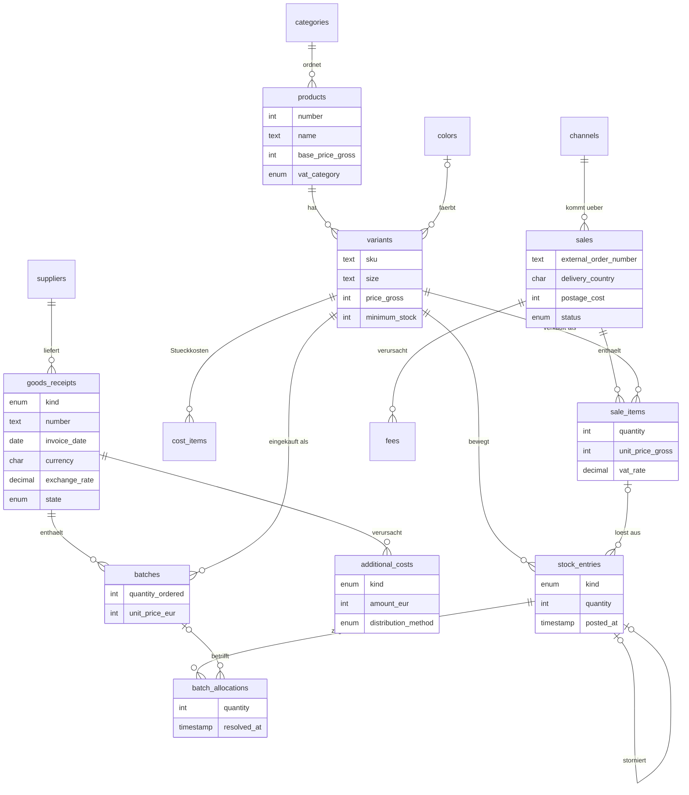

# Domain-Modell – Roslett-Dashboard

Internes Lager- und Kalkulations-Dashboard für den Verkauf von Textilien und Deko (B2C) über den
eigenen Shop und Etsy. Regelbesteuert, vorsteuerabzugsberechtigt; Einkauf teils in Fremdwährung;
im ersten Jahr unter 100 aktive Varianten; Start ohne Altdaten.

Stand: 17.10.2026 · **v2** – Fachkonzept
abgeglichen mit dem Code-Stand nach Phase 2. Einzelentscheidungen: `abgleich.md`.

Tabellen- und Spaltennamen sind englisch (Code-Konvention), Erklärungen deutsch.

---

## 1. Grundentscheidungen

| # | Entscheidung | Begründung |
|---|---|---|
| E1 | Bestand als **chargengenaues Buchungsjournal**, kein Zählerfeld | Nachvollziehbarkeit; Wareneinsatz pro Verkauf exakt |
| E2 | Abgang nach **FIFO**, Chargen sortiert nach Rechnungsdatum | Kaufmännisch üblich, Ware ohne Verfallsdatum |
| E3 | **Varianten** unter einem Produkt; **ein Basis-VK brutto pro Produkt**, Variante kann abweichen; **ein Preis in allen Kanälen** | Wenig Pflege; tatsächlicher Preis steht in jeder Verkaufsposition |
| E4 | Journal **unveränderlich**: Korrektur nur per Storno-Buchung, die auf das Original zeigt | Historie vollständig, Original wird nie angefasst |
| E5 | Nebenkosten eines Wareneingangs werden verteilt, Standard **nach Warenwert**, je Nebenkostenposten umschaltbar auf Stückzahl | Teurere Artikel tragen mehr Fracht; Verpackung o. ä. pro Stück |
| E6 | **Einstand wird berechnet, nicht gespeichert**; nachträgliche Nebenkosten wirken **rückwirkend** | Korrekte Margen auch bei spätem Zollbescheid |
| E7 | **Monatsabschluss** friert Kennzahlen ein; spätere Änderungen erscheinen im laufenden Monat als „Korrektur Vormonate“; ein abgeschlossener Monat wird **nie** wieder geöffnet | Stabile Monatszahlen trotz E6 |
| E8 | Abgänge ohne Bestand werden **mit Warnung gebucht** (Fehlmenge) | Verkauf ist real; Auflösung durch nächsten Zugang oder Inventur |
| E9 | Wechselkurs: **EZB-Referenzkurs am Rechnungsdatum**, automatisch, am Wareneingang eingefroren; manuelle Eingabe als Ausweg | Nachvollziehbar, keine Pflege |
| E10 | **Gebühren** als eigene Tabelle je Verkauf; MVP pauschal aus dem Kanal (% auf Bestellsumme brutto inkl. Versand + fix), später exakt aus der Etsy-API | Einfacher Start, ohne Umbau erweiterbar |
| E11 | **Versand je Bestellung**: Versanderlös (0 ab Grenzwert) und Porto (Standard je Kanal, überschreibbar); anteilig nach Warenwert auf Positionen | Versandkostenfrei ab Warenwert je Kanal |
| E12 | **EU-Ausland**: Lieferland am Verkauf, MwSt-Satz je Position gespeichert (aus Lieferland + MwSt-Kategorie) | Netto-VK und Marge je Zielland korrekt |
| E13 | **SKU automatisch erzeugt**, danach nie änderbar; in Etsy nachgetragen | Etsy-Varianten haben noch keine SKUs; stabile Zuordnung |
| E14 | Geld intern als **ganzzahlige Cent** (`packages/core`), gespeichert als `NUMERIC(14,4)`; Umrechnung nur an der Systemgrenze | Keine Fließkomma-Rundungsfehler |
| E15 | SKU-Schema `ROS-{KAT}-{PRODNR}-{FARBE}-{GROESSE}`, z. B. `ROS-KIS-0012-SAN-4545` | Im Lager lesbar |
| E16 | Monatsabschluss **manuell** per Button | Erst wenn alle Belege erfasst sind |
| E17 | **Kalkulation netto**; Marge und Aufschlag immer getrennt; Einfuhrumsatzsteuer nie im Einstand, Zoll schon | Regelbesteuert, EUSt ist Vorsteuer |
| E18 | **Stückkosten** (Verpackung, Etiketten …) gehen in jede Marge ein: Selbstkosten = Einstand + Stückkosten | Sonst wirkt die Marge zu gut |
| E19 | **Kalkulator**: Zielmarge → Vorschlag Basis-VK brutto, gerechnet mit dem teuersten Kanal | Preisfindung für neue Produkte |
| E20 | Gelöscht wird nichts; Stammdaten werden archiviert (`archived_at`) | Historie bleibt gültig |

---

## 2. Entitäten

Gemeinsam für alle Tabellen: `id` uuid, von der Datenbank erzeugt. „Geld“ = Betrag in Cent an
der API; Speicherung nach Code-Konvention (`money`-Spalte).

### Stammdaten

**categories** – Kategorie-Kürzel, in den Einstellungen pflegbar
| Spalte | Typ | Hinweis |
|---|---|---|
| code | text, eindeutig | 3 Buchstaben, z. B. `KIS`; nach erster Verwendung nicht änderbar |
| name | text | z. B. „Kissen“ |
| group | enum `textile`, `decor` | Filter Textil/Deko |
| archived_at | timestamp | |

Start: KIS Kissen, DCK Decke, TLF Tischläufer, GTS Geschirrtuch-Set (Textil); DEC Deko/Körbe,
VAS Vase, KRZ Kerze (Deko).

**colors** – Farb-Kürzel, in den Einstellungen pflegbar
| Spalte | Typ | Hinweis |
|---|---|---|
| code | text, eindeutig | 3 Buchstaben, z. B. `SAN`; nach erster Verwendung nicht änderbar |
| name | text | z. B. „Sand“ |
| archived_at | timestamp | |

Start: SAN Sand, OLI Olive, NAT Natur, TER Terrakotta, STR Streifen, FEI Feige.

**products**
| Spalte | Typ | Hinweis |
|---|---|---|
| number | int, eindeutig | laufende Produktnummer, in der SKU 4-stellig (`0012`) |
| name | text | |
| description | text | optional |
| category_id | → categories | nach Anlage der ersten Variante nicht mehr änderbar (SKU) |
| base_price_gross | Geld | Basis-VK brutto für alle Varianten und Kanäle |
| vat_category | enum `standard`, `reduced` | |
| archived_at, created_at | timestamp | |

**variants** – jedes Produkt hat mindestens eine Variante
| Spalte | Typ | Hinweis |
|---|---|---|
| product_id | → products | |
| color_id | → colors, optional | |
| size | text, optional | z. B. `45×45`; in der SKU nur Ziffern (`4545`) |
| sku | text, eindeutig | automatisch erzeugt, nie änderbar (E13, E15) |
| price_gross | Geld, optional | Abweichung vom Basis-VK |
| minimum_stock | int | Nachbestell-Hinweis, Standard 0 |
| archived_at, created_at | timestamp | Archivieren nur bei Bestand 0 |

Eindeutig: `product_id + color_id + size`. Der Anzeigename wird aus Farbe und Größe gebildet.

**vat_rates**
| Spalte | Typ | Hinweis |
|---|---|---|
| country | char(2) | Lieferland, z. B. `DE` |
| vat_category | enum | wie products |
| rate | decimal | 0.19 = 19 % |
| valid_from | date | |

**suppliers**: name, country, default_currency (char 3, Vorbelegung im Wareneingang), note,
archived_at, created_at

**channels**
| Spalte | Typ | Hinweis |
|---|---|---|
| name | text | `Shop`, `Etsy` |
| fee_percent | decimal | Pauschale auf Bestellsumme brutto inkl. Versand (E10) |
| fee_fixed | Geld | pro Bestellung |
| shipping_price_gross | Geld | Versandpreis für Kunden |
| free_shipping_from | Geld, optional | Warenwert-Grenze (E11) |
| default_postage | Geld | tatsächliches Porto, Vorbelegung |
| active | bool | |

**cost_items** – Stückkosten (E18)
| Spalte | Typ | Hinweis |
|---|---|---|
| variant_id | → variants, optional | leer = gilt für alle Varianten |
| label | text | z. B. „Verpackung“ |
| kind | enum `fix`, `percent` | `percent` bezieht sich auf den Einstand |
| value | Geld bzw. Rate | |
| active | bool | |

Zoll, Fracht und Einfuhrumsatzsteuer sind **keine** Stückkosten: Zoll und Fracht sind
Nebenkosten eines Wareneingangs, EUSt wird gar nicht erfasst (E17).

### Einkauf

**goods_receipts** – ein Wareneingang = eine Lieferantenrechnung, eine Produktion = eine Nählohnrechnung
| Spalte | Typ | Hinweis |
|---|---|---|
| kind | enum `purchase`, `production` | Zukauf oder Eigenfertigung (C6), beim Anlegen fest |
| number | text, eindeutig | `WE-2026-014` (Zukauf) bzw. `PR-2026-003` (Produktion), je Art eigene Folge |
| supplier_id | → suppliers | Lieferant bzw. Näherei |
| invoice_number | text | |
| invoice_date | date | bestimmt FIFO-Reihenfolge und Kurs |
| currency | char(3) | `EUR`, `USD`, `TRY` … |
| exchange_rate | decimal | EUR → Fremdwährung; 1 bei EUR |
| exchange_rate_source | enum `ecb`, `manual` | |
| state | enum `draft`, `posted` | Entwurf oder gebucht |
| created_at | timestamp | |

Lieferstatus (offen / teilgeliefert / vollständig) wird aus den Zugängen berechnet.

Eine **Produktion** nutzt dieselbe Struktur: Nählohn je Stück ist der Positionspreis
(auch in Fremdwährung), Stoff und Zubehör sind Nebenkosten (Verteilung meist nach Stückzahl),
dazu Fracht und Zoll. Kein Stofflager; Zugang, FIFO und Einstand wie beim Zukauf.

**batches** – Charge = eine Position eines Wareneingangs
| Spalte | Typ | Hinweis |
|---|---|---|
| goods_receipt_id | → goods_receipts | |
| variant_id | → variants | |
| quantity_ordered | int | |
| unit_price_foreign | int | netto, kleinste Einheit der Fremdwährung |
| unit_price_eur | Geld | über eingefrorenen Kurs berechnet (E9) |
| note | text | |

Geliefert = Summe der Zugangsbuchungen. Restmenge = Summe aller Zuordnungen der Charge.

**additional_costs** – Nebenkosten, auch nachträglich
| Spalte | Typ | Hinweis |
|---|---|---|
| goods_receipt_id | → goods_receipts | |
| kind | enum `freight`, `customs`, `fabric`, `accessories`, `other`, `credit` | `credit` negativ; `fabric`/`accessories` für Produktion |
| amount_eur | Geld | |
| distribution_method | enum `value`, `quantity` | Standard `value` (E5) |
| incurred_on | date | |
| note | text | |

> **Einstand pro Stück** (berechnet, E6) = `unit_price_eur` + Anteil der Nebenkosten des
> Wareneingangs. Gerundet erst am Ende.

### Verkauf

**sales** – eine Bestellung
| Spalte | Typ | Hinweis |
|---|---|---|
| channel_id | → channels | |
| external_order_number | text | eindeutig zusammen mit `channel_id` (kein Doppelimport) |
| ordered_at | timestamp | |
| delivery_country | char(2) | (E12) |
| shipping_revenue_gross | Geld | 0 bei versandkostenfrei |
| postage_cost | Geld | Vorbelegung aus Kanal |
| discount_gross | Geld | Rabatt auf Bestellebene |
| status | enum `open`, `shipped`, `cancelled` | Retoure-Status wird aus Buchungen abgeleitet |
| created_at | timestamp | |

**sale_items**
| Spalte | Typ | Hinweis |
|---|---|---|
| sale_id | → sales | |
| variant_id | → variants | |
| quantity | int | |
| unit_price_gross | Geld | tatsächlicher Preis |
| vat_rate | decimal | zum Verkaufszeitpunkt gespeichert |

**fees**
| Spalte | Typ | Hinweis |
|---|---|---|
| sale_id | → sales | |
| kind | enum `transaction`, `payment`, `listing`, `advertising`, `other` | |
| amount | Geld | |
| source | enum `flat`, `api` | |

### Bestandsjournal

**stock_entries** – unveränderlich (E4)
| Spalte | Typ | Hinweis |
|---|---|---|
| variant_id | → variants | |
| kind | enum, siehe Abschnitt 3 | |
| quantity | int, mit Vorzeichen | + Zugang, − Abgang |
| posted_at | timestamp | fachliches Datum |
| created_at | timestamp | technisches Datum |
| note | text | Pflicht bei `shrinkage`, `own_use`, `stocktake` |
| sale_item_id | → sale_items, optional | |
| reverses_id | → stock_entries, optional, eindeutig | nur bei `reversal` |

**batch_allocations** – welche Charge eine Buchung betrifft (persistiert)
| Spalte | Typ | Hinweis |
|---|---|---|
| stock_entry_id | → stock_entries | |
| batch_id | → batches, optional | leer = Fehlmenge (E8) |
| quantity | int, mit Vorzeichen | |
| resolved_at | timestamp, optional | wann eine Fehlmenge einer Charge zugeordnet wurde |

Kein Preis in der Zuordnung: der Wareneinsatz ergibt sich aus Menge × berechnetem Einstand (E6).
Die Zuordnung ist kein Journal; beim Auflösen einer Fehlmenge wird ihr die Charge nachgetragen.

> **Bestand** einer Variante = Summe ihrer Buchungen. **Restmenge** einer Charge = Summe ihrer
> Zuordnungen.

### Abschluss

**month_closings**
| Spalte | Typ | Hinweis |
|---|---|---|
| month | date, eindeutig | Monatserster |
| closed_at | timestamp | |
| snapshot | jsonb | je Variante: Umsatz, Wareneinsatz, Marge, Lagerwert |

---

## 3. Buchungstypen

| Typ (`kind`) | Deutsch | Vorzeichen | Charge |
|---|---|---|---|
| `goods_receipt` | Zugang | + | gelieferte Charge; bei Teillieferung mehrere Zugänge |
| `sale` | Verkauf | − | FIFO; kann mehrere Chargen treffen |
| `return` | Retoure | + | dieselbe(n) Charge(n) wie der ursprüngliche Verkauf |
| `shrinkage` | Schwund | − | FIFO; „Retoure beschädigt“ = Retoure + Schwund |
| `own_use` | Eigenverbrauch | − | FIFO (Fotos, Muster, Geschenke) |
| `stocktake` | Inventur | ± | Plus: neueste Charge · Minus: FIFO |
| `supplier_return` | Rückgabe an Lieferant | − | konkrete Charge |
| `reversal` | Storno | Gegenbuchung | wie Original |

Eigenfertigung braucht keinen eigenen Buchungstyp: Der Zugang einer Produktion ist ein
`goods_receipt` auf eine Charge mit Art `production` (C6, kein Stofflager).

---

## 4. Fachliche Regeln

1. **FIFO:** Chargen der Variante nach `invoice_date` sortiert, ältester Restbestand zuerst.
2. **Fehlmenge:** Reicht der Bestand nicht, wird der Rest ohne Charge zugeordnet. Der nächste
   Zugang oder eine Inventur ordnet automatisch zu; bis dahin ist der Wareneinsatz vorläufig.
3. **Retoure** bucht auf die Chargen des ursprünglichen Verkaufs zurück, nicht per FIFO.
4. **Umtausch** = Retoure + neuer Verkauf.
5. **Storno vor Versand:** Status `cancelled` + Storno-Buchungen; nichts wird gelöscht.
6. **Nachträgliche Nebenkosten/Gutschriften** ändern den Einstand aller Chargen des Wareneingangs
   rückwirkend. Betrifft das einen abgeschlossenen Monat, erscheint die Differenz im laufenden
   Monat als „Korrektur Vormonate“.
7. **Abgeschlossener Monat:** keine Storno-Buchungen mehr; Buchungen mit Datum darin wirken als
   Korrektur im laufenden Monat; nie wieder öffnen.
8. **Doppelter Import:** `channel_id + external_order_number` ist eindeutig.
9. **Rabatt, Versanderlös, Porto, Gebühren** werden nach Warenwert auf die Positionen verteilt.
10. **Variante archivieren** nur bei Bestand 0.
11. **Marge je Verkaufsposition** = VK netto − Wareneinsatz (FIFO) − Stückkosten − Gebühren
    − Porto + Versanderlös netto − Rabatt netto. Marge in % bezogen auf VK netto; Aufschlag
    getrennt, bezogen auf Selbstkosten.
12. **SKU-Bildung:** `ROS-` + Kategorie-Code + `-` + Produktnummer 4-stellig + `-` + Farb-Code
    + `-` + Größe nur Ziffern. Fehlt Farbe oder Größe, entfällt das Segment
    (z. B. `ROS-VAS-0003-TER`).

**Beispiel rückwirkend:** 100 Kissen à 5 €, 60 verkauft, dann Zollbescheid 50 €.
Alle 100 kosten rückwirkend 5,50 €; die 60 verkauften zeigen ihre um 0,50 € kleinere Marge;
Restbestand 40 × 5,50 €.

---

## 5. ER-Diagramm

---

## 6. Bewusst später

- Etsy-Anbindung (Bestellungen importieren, exakte Gebühren, `etsy_listing_id`/`etsy_product_id` an der Variante)
- Sets/Bundles (Stückliste pro Variante)

## 7. Offene Punkte

- [ ] MwSt bei EU-Verkäufen (OSS-Schwelle, Etsy als Marktplatz) mit Steuerberatung klären; das Modell speichert den Satz je Position und ist für beide Fälle offen
- [ ] Kürzel-Listen (Kategorien, Farben) final festlegen – Startwerte siehe oben
- [ ] Echte Werte für Kanalgebühren, Versandpreis, Versandgrenze, Porto
