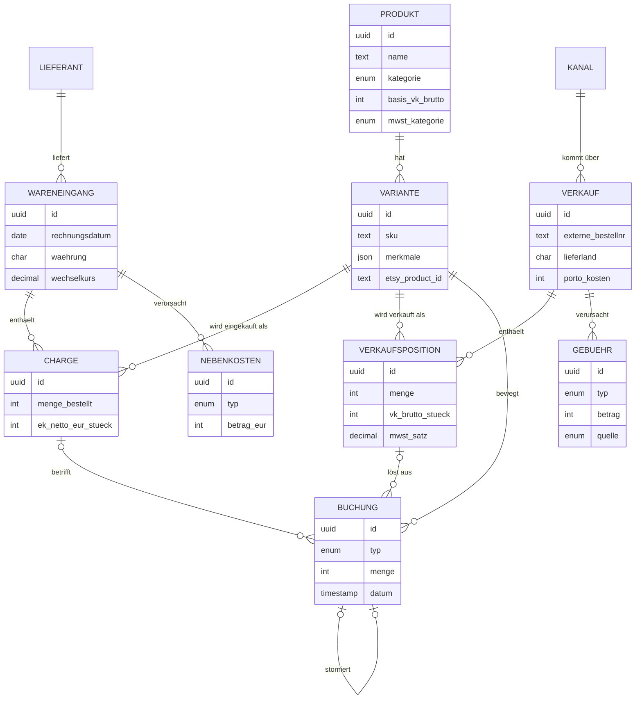

# TRD Dashboard – Zusammenfassung des Chats

Stand: 17.10.2026

Dieser Chat hatte drei Teile:

1. **Stack und Roadmap** des Dashboards.
2. **Domain-Modell** des TRD-Dashboards (`docs/domain-model.md`).
3. **Screens** in Claude Design (Canvas „TRD Dashboard – Screens“, 8 Artboards, Demodaten).

---

## Inhalt

1. [Stack und Roadmap](#1-stack-und-roadmap)
2. [Entscheidungen im Überblick](#2-entscheidungen-im-überblick)
3. [Domain-Modell (vollständig)](#3-domain-modell-vollständig)
4. [Screens](#4-screens)
5. [Design-Grundlagen der Screens](#5-design-grundlagen-der-screens)
6. [Offene Fragen und nächste Schritte](#6-offene-fragen-und-nächste-schritte)
7. [Anhang: Quellcode aller Screens](#7-anhang-quellcode-aller-screens)

---

## 1. Stack und Roadmap

### 1.1 Dashboard-Stack

| Bereich | Technologie | Warum das Dashboard sie braucht |
|---|---|---|
| Framework | Vue 3 (Composition API) + Nuxt | Routing, Server-Routes und Build aus einer Hand |
| Sprache | TypeScript (strict) | FIFO-Chargen, Margen, Währungen: Rechenfehler beim Kompilieren finden |
| Build | Vite (in Nuxt enthalten) | Kommt mit Nuxt |
| Styling | Tailwind CSS + Design-Tokens | Viele Tabellen und Formulare, einheitlicher Look |
| UI-Bausteine | Eigene Komponentenbibliothek (Button, Input, DataTable, Modal) in Histoire | Dieselben Bausteine überall, dokumentiert und isoliert testbar |
| Design | **Claude Design** (statt Figma) vor dem Coden | Erst Screens und Abläufe klären, dann bauen |
| State | Pinia | Filter, Einkaufserfassung, Einstellungen (Währung, MwSt.) |
| Formulare | VeeValidate + Zod | Valide Daten Pflicht; Zod-Schema auch serverseitig |
| Backend | Nuxt Server-Routes (Nitro) als REST-API | Journal und Kalkulation serverseitig |
| Datenbank | PostgreSQL + Drizzle ORM | Relationale Daten, FIFO braucht saubere Abfragen |
| Externe APIs | Etsy Open API, EZB-Wechselkurse | Etsy-Verkäufe buchen Bestand ab; Fremdwährung umrechnen |
| Diagramme | Apache ECharts (vue-echarts) | Marge pro Produkt, Lagerwert, Umsatz nach Kanal |
| Auth | nuxt-auth-utils (Session-Login) | Geschäftsdaten schützen |
| Mobile | Responsive + PWA | Wareneingang am Handy im Lager |
| Barrierefreiheit | WCAG 2.2 AA, axe-Checks | Tastaturbedienung in Tabellen und Formularen |
| Tests | Vitest (FIFO/Marge), Playwright (Wareneingang bis Verkauf) | Kalkulation muss stimmen |
| Qualität | ESLint, Prettier, Lighthouse-Budget | Einheitlicher Code, messbare Performance |
| Git und CI | Feature-Branches, GitHub Actions (Lint, Typecheck, Tests) | Jeder Push geprüft |
| Betrieb | Docker + Deployment, Fehler-Logging | Tool soll wirklich laufen |
| Doku | README, ADRs, Domain-Modell | Doku gefordert; Brücke zur Business-Analyse |

Optional: KI-Entwurf für Etsy-Listing-Texte, nur wenn selbst gewollt.

Bewusst nicht im Dashboard: GSAP, Three.js, Bootstrap, React, AWS/Azure-Dienste. Dezente Übergänge mit Vue `<Transition>`.

### 1.2 Feature-Roadmap

**M1 – Fundament (Woche 1–2)**
- [ ] Claude Design: Kern-Screens (erledigt, siehe Abschnitt 4)
- [ ] Domain-Modell schriftlich (erledigt, siehe Abschnitt 3)
- [ ] Nuxt + TypeScript strict + Tailwind + ESLint/Prettier, Repo mit README
- [ ] Design-Tokens und 5 Basiskomponenten in Histoire
- [ ] GitHub Actions: Lint + Typecheck

**M2 – Kernfunktion vorzeigbar (Woche 3–4)**
- [ ] PostgreSQL + Drizzle: Tabellen, Migrationen, Seed-Daten
- [ ] REST-Endpunkte für Produkte, Varianten, Wareneingänge
- [ ] Formulare mit VeeValidate + Zod
- [ ] Bestandsjournal mit FIFO-Logik + Vitest
- [ ] Login, Docker-Deployment, Live-Demo mit Demodaten

**M3 – Geschäftswert (Woche 5–7)**
- [ ] Margen inkl. MwSt. und Fremdwährung (EZB-Kurs am Rechnungsdatum)
- [ ] Etsy-Anbindung: Bestellungen abrufen, Bestand abbuchen
- [ ] ECharts-Diagramme
- [ ] Pinia für Filter und Einstellungen

**M4 – Feinschliff (Woche 8–10)**
- [ ] Playwright-E2E
- [ ] Barrierefreiheit (axe, Tastatur), Lighthouse-Budget in CI
- [ ] PWA
- [ ] ADRs, Screenshots, Demo-Video im README

## 2. Entscheidungen im Überblick

### Domain / Fachlich
| Frage | Entscheidung |
|---|---|
| Nebenkosten-Verteilung | nach Warenwert |
| Kanalgebühren | eigene Tabelle; MVP pauschal (% + fix) pro Kanal, später exakt aus Etsy-API |
| Versand | bis zu einem Warenwert zahlt Kunde, danach kostenlos; Grenze pro Kanal |
| Zusätzliche Buchungstypen | Retoure, Schwund/Beschädigung, Eigenverbrauch/Muster, Inventurkorrektur, plus Rückgabe an Lieferant und Storno |
| Nachträgliche Kosten | rückwirkend neu berechnen + Monatsabschluss |
| Fehlbestand bei Etsy-Verkauf | erlauben mit Warnung |
| Sets / Eigenfertigung | noch offen, nicht im MVP, Modell vorbereitet |
| Wechselkurs | EZB-Kurs am Rechnungsdatum |
| Absatzgebiet | auch EU-Ausland |
| Etsy-SKUs | existieren noch nicht, Dashboard vergibt sie |
| SKU-Schema | sprechend: `TRD-{KAT}-{PRODNR}-{FARBE}-{GROESSE}` |
| Monatsabschluss | manuell per Button |
| Doku-Format | Markdown + Mermaid-ER-Diagramm im Repo |

### Design
| Frage | Entscheidung |
|---|---|
| Stil | ruhig, warm, an die Marke angelehnt (Leinengrau + Oliv) – bestätigt |
| Markenfarben vorhanden | nein, Vorschlag übernommen |
| Geräte | Desktop + Handy für Wareneingang |
| UI-Sprache | Deutsch |
| Produktdetail | Tabs (Varianten / Chargen / Journal), Marge als Seitenleiste |
| Zusätzliche Screens | Verkäufe/Etsy-Import, Bestandsjournal, Einstellungen |
| Design System | keins vorhanden |

### Projekt-Setup
| Frage | Entscheidung |
|---|---|
| Repo | noch nicht angelegt; Grundgerüst wird hier gebaut und übergeben |
| Paketmanager | pnpm |
| Nächster Schritt | Screens zuerst durchklicken, dann Setup |

---

## 3. Domain-Modell (vollständig)

Internes Lager- und Kalkulations-Dashboard für den Verkauf von Textilien und Deko (B2C) über den eigenen Shop und Etsy. Status: Entwurf v1.

Weitere Rahmendaten: regelbesteuert, vorsteuerabzugsberechtigt; Einkauf teils in Fremdwährung; im ersten Jahr unter 100 aktive Varianten; Start ohne Altdaten.

### 3.1 Grundentscheidungen

| # | Entscheidung | Begründung |
|---|---|---|
| E1 | Bestand wird als **chargengenaues Buchungsjournal** geführt, nicht als Zählerfeld | Nachvollziehbarkeit; Wareneinsatz pro Verkauf exakt bestimmbar |
| E2 | Abgang nach **FIFO** (älteste Charge mit Restbestand zuerst) | Kaufmännisch üblich, passt zu Ware ohne Verfallsdatum |
| E3 | **Varianten** unter einem Elternprodukt, ein **Basis-Verkaufspreis** pro Produkt | Weniger Pflegeaufwand; tatsächlicher Preis steht ohnehin in jeder Verkaufsposition |
| E4 | Das Journal ist **unveränderlich**: Fehler werden per Storno-Buchung korrigiert, nie bearbeitet oder gelöscht | Wie in der Buchhaltung; Historie bleibt vollständig |
| E5 | Nebenkosten (Fracht, Zoll) werden **nach Warenwert** auf die Chargen eines Wareneingangs verteilt | Teurere Artikel tragen mehr Kosten |
| E6 | Wareneinsatz wird **nicht gespeichert, sondern berechnet** (Charge + Nebenkosten + Journal); nachträgliche Kosten wirken **rückwirkend** | Korrekte Margen auch bei spätem Zollbescheid |
| E7 | **Monatsabschluss** friert Kennzahlen abgeschlossener Monate ein; spätere Korrekturen erscheinen im laufenden Monat als „Korrektur Vormonate“ | Stabile Monatszahlen trotz E6 |
| E8 | Verkäufe ohne Bestand werden **mit Warnung gebucht** (Fehlmenge) | Der Verkauf ist real; Fehlmenge wird durch Wareneingang oder Inventur aufgelöst |
| E9 | Wechselkurs: **EZB-Referenzkurs am Rechnungsdatum**, automatisch abgerufen und am Wareneingang gespeichert | Nachvollziehbar, keine manuelle Pflege |
| E10 | **Gebühren** als eigene Tabelle pro Verkauf: im MVP pauschal pro Kanal (% + fix), später exakt aus der Etsy-API | Einfacher Start, ohne Umbau erweiterbar |
| E11 | **Versand pro Bestellung**: Versanderlös (0 € ab Grenzwert) und tatsächliches Porto; für die Produktmarge anteilig nach Warenwert auf Positionen verteilt | Versandkostenfrei ab einem Warenwert pro Kanal |
| E12 | **Verkauf ins EU-Ausland** möglich: MwSt.-Satz wird pro Verkaufsposition gespeichert, Lieferland am Verkauf | Netto-VK und Marge korrekt je Zielland |
| E13 | **SKUs werden im Dashboard vergeben** und in Etsy nachgetragen | Etsy-Varianten haben noch keine SKUs |
| E14 | Geldbeträge als **Ganzzahl in Cent** (bzw. kleinster Währungseinheit) | Keine Rundungsfehler durch Fließkommazahlen |
| E15 | **Sprechende SKUs** nach Schema `TRD-{KAT}-{PRODNR}-{FARBE}-{GROESSE}`, z. B. `TRD-KIS-0012-BEI-4545`; eine einmal vergebene SKU wird nie geändert | Im Lager lesbar; Stabilität für Etsy-Zuordnung und Historie |
| E16 | **Monatsabschluss manuell** per Button | Abschluss erst, wenn alle Belege des Monats erfasst sind |

### 3.2 Entitäten

#### Stammdaten

**Produkt** (Elternprodukt)
| Feld | Typ | Hinweis |
|---|---|---|
| id | uuid | |
| name | text | |
| kategorie | enum | `textil`, `deko` |
| beschreibung | text | optional |
| basis_vk_brutto | int (Cent) | Standardpreis für alle Varianten |
| mwst_kategorie | enum | `normal`, `ermaessigt` |
| aktiv | bool | |

**Variante**
| Feld | Typ | Hinweis |
|---|---|---|
| id | uuid | |
| produkt_id | → Produkt | |
| sku | text, eindeutig | im Dashboard vergeben (E13) |
| merkmale | json | z. B. `{ "farbe": "beige", "groesse": "45x45" }` |
| etsy_listing_id | text | optional |
| etsy_product_id | text | optional; Etsy-Variante innerhalb des Listings |
| mindestbestand | int | optional, für Nachbestell-Hinweis |
| aktiv | bool | Deaktivieren nur bei Bestand 0 |

**Lieferant**: id, name, land, standard_waehrung

**Kanal**
| Feld | Typ | Hinweis |
|---|---|---|
| id | uuid | |
| name | text | `Shop`, `Etsy` |
| gebuehr_prozent | decimal | Pauschale im MVP (E10) |
| gebuehr_fix | int (Cent) | pro Bestellung |
| versandpreis_brutto | int (Cent) | Standard-Versandpreis |
| versandkostenfrei_ab | int (Cent) | Warenwert-Grenze (E11) |

**MwSt-Satz**: land, mwst_kategorie, satz, gueltig_ab

#### Einkauf

**Wareneingang**
| Feld | Typ | Hinweis |
|---|---|---|
| id | uuid | |
| lieferant_id | → Lieferant | |
| rechnungsnr | text | |
| rechnungsdatum | date | |
| waehrung | char(3) | z. B. `EUR`, `USD`, `TRY` |
| wechselkurs | decimal | EZB-Kurs am Rechnungsdatum (E9); 1 bei EUR |
| status | enum | `offen`, `teilgeliefert`, `vollstaendig` |

**Charge** (= eine Position eines Wareneingangs)
| Feld | Typ | Hinweis |
|---|---|---|
| id | uuid | |
| wareneingang_id | → Wareneingang | |
| variante_id | → Variante | |
| menge_bestellt | int | |
| ek_netto_fw_stueck | int | in Fremdwährung (kleinste Einheit) |
| ek_netto_eur_stueck | int (Cent) | berechnet über Wechselkurs |

**Nebenkosten** (eigene Tabelle, damit nachträglich erfassbar)
| Feld | Typ | Hinweis |
|---|---|---|
| id | uuid | |
| wareneingang_id | → Wareneingang | |
| typ | enum | `fracht`, `zoll`, `sonstiges`, `gutschrift` (negativ) |
| betrag_eur | int (Cent) | |
| datum | date | |

> **Einstandspreis pro Stück** (berechnet) = `ek_netto_eur_stueck` + Anteil der Nebenkosten des Wareneingangs nach Warenwert (E5).

#### Verkauf

**Verkauf** (= eine Bestellung)
| Feld | Typ | Hinweis |
|---|---|---|
| id | uuid | |
| kanal_id | → Kanal | |
| externe_bestellnr | text | eindeutig pro Kanal → verhindert doppelten Etsy-Import |
| datum | timestamp | |
| lieferland | char(2) | für MwSt. (E12) |
| versanderloes_brutto | int (Cent) | 0 bei versandkostenfrei |
| porto_kosten | int (Cent) | tatsächliches Porto |
| rabatt_brutto | int (Cent) | Rabattcode auf Bestellebene, anteilig nach Warenwert verteilt |
| status | enum | `offen`, `versendet`, `storniert` |

**Verkaufsposition**
| Feld | Typ | Hinweis |
|---|---|---|
| id | uuid | |
| verkauf_id | → Verkauf | |
| variante_id | → Variante | |
| menge | int | |
| vk_brutto_stueck | int (Cent) | tatsächlicher Preis |
| mwst_satz | decimal | zum Verkaufszeitpunkt gespeichert |

**Gebühr**
| Feld | Typ | Hinweis |
|---|---|---|
| id | uuid | |
| verkauf_id | → Verkauf | |
| typ | enum | `transaktion`, `zahlung`, `listing`, `werbung`, `sonstiges` |
| betrag | int (Cent) | |
| quelle | enum | `pauschal`, `api` |

#### Bestandsjournal

**Buchung**
| Feld | Typ | Hinweis |
|---|---|---|
| id | uuid | |
| variante_id | → Variante | |
| charge_id | → Charge, nullable | leer = Fehlmenge (E8) |
| typ | enum | siehe 3.3 |
| menge | int, mit Vorzeichen | + Zugang, − Abgang |
| datum | timestamp | fachliches Datum |
| verkaufsposition_id | → Verkaufsposition, nullable | |
| storno_von_id | → Buchung, nullable | bei Storno-Buchungen |
| notiz | text | Pflicht bei Schwund, Eigenverbrauch, Inventur |
| erstellt_am | timestamp | technisches Datum |

> **Bestand** einer Variante = Summe aller Buchungen. **Restbestand einer Charge** = Summe ihrer Buchungen.

#### Abschluss

**Monatsabschluss**: monat, abgeschlossen_am, snapshot (json: Umsatz, Wareneinsatz, Marge, Lagerwert je Variante)

### 3.3 Buchungstypen

| Typ | Vorzeichen | Charge | Hinweis |
|---|---|---|---|
| `zugang` | + | die gelieferte Charge | bei Teillieferung mehrere Zugänge pro Charge |
| `verkauf` | − | per FIFO ermittelt | eine Verkaufsposition kann mehrere Chargen treffen |
| `retoure` | + | dieselbe(n) Charge(n) wie der ursprüngliche Verkauf | Teilretoure möglich |
| `schwund` | − | per FIFO | Beschädigung, Verlust; auch „Retoure beschädigt“ = Retoure + Schwund |
| `eigenverbrauch` | − | per FIFO | Fotos, Muster, Geschenke |
| `inventur` | ± | Plus: neueste Charge · Minus: per FIFO | Abgleich mit gezähltem Bestand |
| `rueckgabe_lieferant` | − | konkrete Charge | Reklamation |
| `storno` | Gegenbuchung | wie Original | korrigiert eine fehlerhafte Buchung (E4) |
| *später:* `materialverbrauch` | − | per FIFO | Eigenfertigung |
| *später:* `fertigungszugang` | + | neue Fertigungs-Charge | Einstandspreis = Summe Materialverbrauch |

### 3.4 Fachliche Regeln und Edge Cases

1. **FIFO-Zuordnung:** Bei jedem Abgang werden die Chargen der Variante nach Rechnungsdatum sortiert und vom ältesten Restbestand abgebucht.
2. **Fehlmenge (E8):** Reicht der Bestand nicht, wird der Rest ohne Charge gebucht und als Fehlmenge markiert. Der nächste Zugang oder eine Inventur löst sie auf; erst dann ist der Wareneinsatz dieser Position vollständig.
3. **Retoure:** bucht auf die Chargen zurück, die der ursprüngliche Verkauf belastet hat – nicht per FIFO.
4. **Umtausch:** Retoure + neuer Verkauf.
5. **Storno vor Versand:** Status `storniert` + Storno-Buchungen; keine Löschung.
6. **Nachträgliche Nebenkosten/Gutschriften:** neuer Eintrag in *Nebenkosten*; der Einstandspreis aller Chargen des Wareneingangs ändert sich rückwirkend (E6). Betrifft das einen abgeschlossenen Monat, wird die Differenz im laufenden Monat als „Korrektur Vormonate“ ausgewiesen (E7).
7. **Doppelter Import:** `kanal_id + externe_bestellnr` ist eindeutig.
8. **Rabatt auf Bestellebene:** anteilig nach Warenwert auf die Positionen verteilt.
9. **Variante deaktivieren:** nur bei Bestand 0.
10. **Marge pro Verkaufsposition** = VK netto − FIFO-Wareneinsatz − anteilige Gebühren − anteiliges Porto + anteiliger Versanderlös (netto) − anteiliger Rabatt (netto).

Weitere im Chat genannte Edge Cases (abgedeckt durch die Regeln oben): Teilretoure; Retoure beschädigt (Retoure + Schwund); Rücksendung an Lieferanten; fehlerhafte Erfassung (nur Storno); Teillieferungen beim Wareneingang; Preisänderungen (unkritisch, weil jede Position den tatsächlichen Preis speichert); Verkauf auf Etsy trotz Bestand 0.

**Beispiel rückwirkende Berechnung (aus dem Chat):** 100 Kissen à 5 € eingekauft, 60 verkauft, dann Zollbescheid über 50 € (0,50 € pro Stück).
- Rückwirkend: alle 100 kosten 5,50 €; die 60 verkauften zeigen ihre echte, um 0,50 € kleinere Marge; Restbestand 40 × 5,50 €.
- Nur Restbestand: 50 € auf 40 Stück → 6,25 € pro Stück; verkaufte wirken zu gut, restliche zu schlecht.
- Gewählt: rückwirkend + Monatsabschluss.

### 3.5 ER-Diagramm



### 3.6 Bewusst später

- **Sets/Bundles:** optionale Stückliste pro Variante; ein Set-Verkauf bucht die enthaltenen Varianten ab
- **Eigenfertigung:** Buchungstypen `materialverbrauch` und `fertigungszugang`
- **Exakte Etsy-Gebühren** über die API (M3)

---

## 4. Screens

Canvas „TRD Dashboard – Screens“ in Claude Design, 8 Artboards. Alle Desktop-Screens sind fluide Seiten (Seitennavigation links, auf schmalen Bildschirmen umbrechend) und im Play-Modus über die Navigation verlinkt. Alle Zahlen sind **Demodaten**, aber in sich stimmig.

Durchgehendes Beispiel: Variante `TRD-KIS-0012-SAN-4545` (Leinenkissen Sand 45×45) hat eine **Fehlmenge von −1** nach Etsy #3318; sie wird beim Buchen von **WE-2026-014** aufgelöst.

Gemeinsame Navigation: Übersicht · Produkte · Wareneingang · Verkäufe · Bestandsjournal · Einstellungen.

### 4.1 Übersicht (`Main.dc.html`)
- **Zweck:** Monatsüberblick und Handlungsbedarf.
- **Kopf:** „Oktober 2026 · offen“, Zeitraum-Auswahl, Button „Monat abschließen“.
- **Warnbanner:** 2 Etsy-Verkäufe ohne Bestand (SKUs genannt), Link „Wareneingang erfassen“.
- **KPI-Kacheln:** Lagerwert zu Einstandspreisen (8.420 €, 1.146 Stück, 64 Varianten), Umsatz netto Oktober (3.180 €; Shop 1.840 €, Etsy 1.340 €), Marge Oktober (1.240 €, 39 %), offene Fehlmengen (2).
- **Diagramm:** Umsatz netto nach Kanal (Shop/Etsy), Mai–Oktober, gruppierte Balken.
- **Marge nach Produkt:** Top 5 mit Betrag, Prozent und Balken.
- **Nachbestellen:** Varianten unter Mindestbestand (SKU, Produkt, Bestand, Mindest).
- **Letzte Buchungen:** Datum, Typ-Badge, SKU, Menge; Link zum Journal.

### 4.2 Produktliste (`Produkte.dc.html`)
- **Zweck:** alle Produkte finden und Zustand erkennen.
- **Filter:** Suche (Name/SKU), Kategorie (Alle/Textil/Deko), Bestand (Alle/Unter Mindestbestand/Fehlmenge/Ausverkauft), Checkbox „Nur aktive“; Button „Neues Produkt“.
- **Tabelle:** Produkt + SKU-Stamm, Kategorie, Varianten, Bestand (mit Badge Fehlmenge / unter Mindest), Basis-VK brutto, Ø Einstand, Marge, Etsy-Verknüpfung („x von y verknüpft“ / „nicht auf Etsy“).
- **Hinweis:** Marge hier = Basis-VK netto − Ø Einstand (FIFO), vor Gebühren und Versand.
- **Ablauf:** Klick auf Produkt → Produktdetail.

### 4.3 Produktdetail (`Produktdetail.dc.html`)
- **Kopf:** Leinenkissen Sand, `TRD-KIS-0012`, Textil, Basis-VK 39,90 € brutto, MwSt. normal, 86 Stück; Buttons „Bearbeiten“, „Variante hinzufügen“.
- **Tabs (interaktiv):**
  - *Varianten (4):* SKU, Größe, Bestand, Mindest, Lagerwert, Etsy-Variante; Fehlmengen-Zeile hervorgehoben.
  - *Chargen:* Variantenauswahl; Wareneingang, Datum, Lieferant, Menge, Rest, Einstand/Stk, Status (aufgebraucht / Fehlmenge / als Nächstes). Hinweis, dass die Fehlmenge beim Buchen von WE-2026-014 zugeordnet wird.
  - *Journal:* Datum, Typ, Beleg, Charge, Menge, laufender Bestand; Hinweis auf Unveränderlichkeit; Link ins globale Journal.
- **Seitenleiste „Marge eines Verkaufs“ (Etsy #3291):** VK netto 33,53 € (39,90 € brutto, 19 %) − Wareneinsatz 9,48 € (FIFO WE-2026-012) − Gebühren Etsy 4,49 € (pauschal) − Porto 4,95 € + Versanderlös netto 4,12 € = **18,73 € · 56 %**.

Journal-Beispiel 45×45 (rückwärts): Zugang +40 → 40 · Eigenverbrauch −2 → 38 · 11 Bestellungen −34 → 4 · Retoure +1 → 5 · Etsy #3291 −1 → 4 · Shop #1044 −3 → 1 · Etsy #3318 −2 → −1 (davon 1 aus WE-2026-012, 1 Fehlmenge).

### 4.4 Wareneingang Desktop (`Wareneingang.dc.html`)
- **Zweck:** Lieferantenrechnung mit Positionen und Nebenkosten erfassen.
- **Kopf:** WE-2026-014 · Entwurf; Buttons „Als Entwurf speichern“, „Zugang buchen“.
- **Rechnung:** Lieferant (Lino Tekstil, TR), Rechnungsnummer, Rechnungsdatum, Währung (TRY/EUR/USD); Wechselkurs-Zeile „1 EUR = 47,85 TRY, EZB-Referenzkurs vom Rechnungsdatum, automatisch abgerufen“.
- **Positionen:** Variante + SKU, Menge (Eingabe), EK netto TRY (Eingabe), EK netto EUR, Nebenkosten/Stk, Einstand/Stk; Button „Position hinzufügen (SKU suchen oder scannen)“.
  - 45×45: 40 × 380 TRY → 7,94 € + 1,37 € = 9,31 €
  - 50×50: 30 × 410 TRY → 8,57 € + 1,48 € = 10,05 €
  - 60×60: 20 × 470 TRY → 9,82 € + 1,70 € = 11,52 €
  - Tischläufer 40×150: 30 × 420 TRY → 8,78 € + 1,52 € = 10,30 €
- **Nebenkosten:** Fracht 96,00 €, Zoll 82,76 €, „Weitere Kosten oder Gutschrift“; Hinweis auf rückwirkende Anpassung.
- **Zusammenfassung:** 4 Positionen · 120 Stück, Warenwert 1.034,50 €, Nebenkosten 178,76 €, Einstand gesamt 1.213,26 €; Hinweis auf Zuordnung der Fehlmenge; Checkbox Teillieferung.

### 4.5 Wareneingang Handy (`WareneingangMobil.dc.html`, 390 × 844)
- **Zweck:** Lieferung im Lager prüfen, Teillieferung buchen.
- **Kopf:** Zurück-Link, WE-2026-014 · Lino Tekstil, Fortschrittsbalken „Geliefert x von 120“.
- **Button:** „SKU-Etikett scannen“.
- **Positionskarten (interaktiv):** Name, SKU, Status-Badge (vollständig / offen n / Mehrlieferung), bestellt, Plus/Minus-Stepper.
- **Fuß:** Hinweis „Teillieferung: n Stück bleiben offen“, Button „x Stück als Teillieferung buchen“ bzw. „Zugang buchen“. Startzustand: Tischläufer 18 von 30.

### 4.6 Verkäufe & Etsy-Import (`Verkaeufe.dc.html`)
- **Kopf:** Oktober 2026 · 41 Bestellungen; Buttons „Shop-Bestellung erfassen“ (Shop im MVP manuell), „Etsy jetzt abrufen“.
- **Letzter Etsy-Import:** 3 neu gebucht, 1 übersprungen (bereits importiert), 1 mit Fehlmenge; Duplikaterkennung über Etsy-Bestellnummer; Abruf alle 30 Minuten.
- **Nicht zugeordnet:** Etsy-Variante ohne SKU (Tischläufer 40×200) – Bestellungen werden erst nach Verknüpfung gebucht.
- **Filter:** Suche (Bestellnummer/SKU), Kanal, Status (Offen/Versendet/Retoure/Storniert/Fehlmenge).
- **Tabelle:** Datum, Kanal, Bestellung, Land (DE/AT/NL/FR), Stück, Umsatz brutto, Marge (vorläufig bei Fehlmenge, „—“ bei Storno), Status (Fehlmenge/Offen/Versendet/Teilretoure/Storniert).

### 4.7 Bestandsjournal (`Journal.dc.html`)
- **Kopf:** „Alle Bestandsbewegungen · unveränderlich“; Buchungsart (Schwund / Eigenverbrauch / Inventurkorrektur / Rückgabe an Lieferant) + „Buchung erfassen“.
- **Hinweis:** abgeschlossen bis September 2026; dort kein Storno, Korrekturen im laufenden Monat.
- **Filter:** SKU oder Beleg, Typ, Zeitraum, „Nur Fehlmengen“.
- **Tabelle:** Nr., Datum, Typ, SKU, Charge, Menge, Beleg/Notiz, Aktion „Stornieren“ bzw. „abgeschlossen“.
- **Beispiele:** Verkauf aufgeteilt auf Charge + Fehlmenge; Teillieferung 24 von 30; Retoure auf ursprüngliche Charge; Storno-Paar (#2058 Schwund −3 durchgestrichen, #2060 Storno +3, #2061 korrekter Schwund −1); Rückgabe an Lieferant (Webfehler); Inventur (gezählt 46, Soll 48); gesperrte Buchung aus September.

### 4.8 Einstellungen (`Einstellungen.dc.html`)
- **Verkaufskanäle:** je Kanal Gebühr %, Fix pro Bestellung, Versandpreis brutto, versandkostenfrei ab.
  - Eigener Shop (manuelle Erfassung): 1,5 % + 0,25 €, Versand 4,90 €, frei ab 50,00 €
  - Etsy · [DEIN ETSY-SHOP] (verbunden): 10,5 % + 0,30 €, Versand 4,90 €, frei ab 50,00 €
  - Alles Beispielwerte, mit aktuellen Konditionen abgleichen.
- **SKU-Schema:** `TRD-{Kategorie}-{Produktnr.}-{Farbe}-{Größe}`; Kategorie-Kürzel KIS Kissen, DCK Decke, TLF Tischläufer, GTS Geschirrtuch-Set, DEC Deko allgemein/Körbe, VAS Vase, KRZ Kerze; Farb-Kürzel SAN Sand, OLI Olive, NAT Natur, TER Terrakotta, STR Streifen, FEI Feige.
- **MwSt.-Sätze nach Lieferland:** DE 19/7 %, AT 20/10 %, NL 21/9 %, FR 20/5,5 % (Gültig-ab im Ausland „[PRÜFEN]“); Hinweis OSS/Etsy mit Steuerberatung klären.
- **Monatsabschlüsse:** Juli–September abgeschlossen, Oktober offen mit 1 Korrektur Vormonate; Button „Oktober 2026 abschließen“.

---

## 5. Design-Grundlagen der Screens

| Token | Wert | Verwendung |
|---|---|---|
| Grund | `#F3F0EA` | Seitenhintergrund (Leinengrau) |
| Navigation | `#FBFAF7` | Seitenleiste, Kopf/Fuß mobil |
| Fläche | `#FFFFFF` | Karten, Tabellen |
| Rahmen | `#E2DCD2` / Linien `#EEE9E1` / Eingabe `#D6CFC3` | |
| Text | `#23211E` | |
| Text gedämpft | `#6B645A` | Labels, Hinweise |
| Akzent | `#4A5A34` (Oliv), dunkel `#2F3A20`, hell `#E6EAD9` | Buttons, aktive Navigation, Balken |
| Zweitfarbe Diagramm | `#C9A27A` (Sand) | Etsy-Balken |
| Warnung | Fläche `#FBEBD0`, Text `#6E4200` / `#8A5300`, Rahmen `#E8C98F` | Fehlmenge, unter Mindest |
| Info | `#E3ECF3` / `#24435C` | Retoure, offen |
| Storno | `#F3DCD6` / `#7A2E1C` | |
| Schrift UI | Instrument Sans (400–700) | |
| Schrift Zahlen/SKUs | IBM Plex Mono, `tabular-nums` | |
| Radien | 8 px (Felder/Buttons), 12 px (Karten), 999 px (Badges) | |
| Touch-Ziele | mind. 44 px | |

---

## 6. Offene Fragen und nächste Schritte

### Offene Fragen
- [ ] MwSt. bei EU-Verkäufen (OSS-Schwelle, Rolle von Etsy als Marktplatz) mit Steuerberatung klären; Modell speichert den Satz pro Position und ist für beide Fälle offen.
- [ ] Kürzel-Listen für SKUs final festlegen (Kategorien, Farben).
- [ ] Sets/Bundles und Eigenfertigung: kommen sie, und wann?
- [ ] Echte Werte für Kanalgebühren, Versandpreis und Versandkostengrenze.
- [ ] KM2-Anzeige gegen Original prüfen.
- [ ] Optionales KI-Feature (Etsy-Listing-Texte) ja/nein.

### Nächste Schritte
1. Screens im Canvas durchklicken und Änderungen melden (läuft).
2. Projekt-Setup: Grundgerüst mit Nuxt, TypeScript strict, Tailwind (Tokens aus Abschnitt 5), ESLint/Prettier, **pnpm**, `docs/domain-model.md`; wird hier gebaut und als Ordner übergeben, da das Repo noch nicht existiert.
3. Danach M1 fortsetzen: Basiskomponenten in Histoire, GitHub Actions.

---

## 7. Anhang: Quellcode aller Screens

Vollständiger, ungekürzter Quellcode der acht Artboards und des Canvas-Index aus Claude Design.

### canvas.json

```json
{
  "v": 3,
  "createdOnFiles": {"v": 1, "at": "2026-10-17T12:00:00Z"},
  "title": "TRD Dashboard – Screens",
  "launch": {"view": "canvas"},
  "pages": [],
  "boards": {
    "Main.dc.html": {"x": 0, "y": 0, "w": 1440, "h": 1180, "title": "Übersicht", "expand": "fill", "is_interactive": true},
    "Produkte.dc.html": {"x": 1520, "y": 0, "w": 1440, "h": 900, "title": "Produktliste", "expand": "fill", "is_interactive": true},
    "Produktdetail.dc.html": {"x": 3040, "y": 0, "w": 1440, "h": 1000, "title": "Produktdetail", "expand": "fill", "is_interactive": true},
    "Wareneingang.dc.html": {"x": 0, "y": 1520, "w": 1440, "h": 1180, "title": "Wareneingang (Desktop)", "expand": "fill", "is_interactive": true},
    "WareneingangMobil.dc.html": {"x": 1520, "y": 1520, "w": 390, "h": 844, "title": "Wareneingang (Handy)", "is_interactive": true},
    "Verkaeufe.dc.html": {"x": 1990, "y": 1520, "w": 1440, "h": 1000, "title": "Verkäufe & Etsy-Import", "expand": "fill", "is_interactive": true},
    "Journal.dc.html": {"x": 3510, "y": 1520, "w": 1440, "h": 1040, "title": "Bestandsjournal", "expand": "fill", "is_interactive": true},
    "Einstellungen.dc.html": {"x": 0, "y": 2820, "w": 1440, "h": 1500, "title": "Einstellungen", "expand": "fill", "is_interactive": true}
  },
  "order": ["Main.dc.html", "Produkte.dc.html", "Produktdetail.dc.html", "Wareneingang.dc.html", "WareneingangMobil.dc.html", "Verkaeufe.dc.html", "Journal.dc.html", "Einstellungen.dc.html"],
  "notes": {
    "titel": {"x": 0, "y": -300, "text": "TRD Dashboard – Kern-Screens (Demodaten)", "kind": "title1", "maxW": 4950}
  },
  "designSystems": []
}
```

### Main.dc.html

```html
<!doctype html>
<html lang="de">
<head>
<meta charset="utf-8">
<title>TRD – Übersicht</title>
<script src="./support.js"></script>
</head>
<body>
<x-dc>
<helmet>
<link rel="preconnect" href="https://fonts.googleapis.com">
<link href="https://fonts.googleapis.com/css2?family=Instrument+Sans:wght@400;500;600;700&amp;family=IBM+Plex+Mono:wght@400;500&amp;display=swap" rel="stylesheet">
<style>
body{margin:0;background:#F3F0EA}
a{color:#4A5A34}a:hover{color:#2F3A20}
.num{font-family:'IBM Plex Mono',ui-monospace,monospace;font-variant-numeric:tabular-nums}
th{text-align:left;font-weight:500;font-size:12px;color:#6B645A;padding:10px 12px;border-bottom:1px solid #E2DCD2;white-space:nowrap}
td{padding:12px;border-bottom:1px solid #EEE9E1;font-size:14px;white-space:nowrap}
</style>
</helmet>
<div style="min-height: 100vh; display: flex; flex-wrap: wrap; font-family: 'Instrument Sans', system-ui, sans-serif; color: #23211E; background: #F3F0EA">

<nav aria-label="Hauptnavigation" style="flex: 1 1 232px; max-width: 100%; box-sizing: border-box; padding: 28px 20px; display: flex; flex-direction: column; gap: 4px; background: #FBFAF7; border-right: 1px solid #E2DCD2">
<div style="display: flex; align-items: center; gap: 10px; padding: 0 12px 24px">
<div style="width: 36px; height: 36px; border-radius: 8px; background: #4A5A34; color: #FFFFFF; display: flex; align-items: center; justify-content: center; font-weight: 700; font-size: 14px; letter-spacing: 0.5px">TRD</div>
<div style="display: flex; flex-direction: column"><span style="font-weight: 600; font-size: 15px">The Refined Decor</span><span style="font-size: 12px; color: #6B645A">Lager &amp; Kalkulation</span></div>
</div>
<a href="Main.dc.html" aria-current="page" style="display: flex; align-items: center; gap: 10px; padding: 11px 12px; border-radius: 8px; background: #E6EAD9; color: #2F3A20; font-weight: 600; font-size: 14px; text-decoration: none">Übersicht</a>
<a href="Produkte.dc.html" style="display: flex; align-items: center; gap: 10px; padding: 11px 12px; border-radius: 8px; color: #23211E; font-size: 14px; text-decoration: none">Produkte</a>
<a href="Wareneingang.dc.html" style="display: flex; align-items: center; gap: 10px; padding: 11px 12px; border-radius: 8px; color: #23211E; font-size: 14px; text-decoration: none">Wareneingang</a>
<a href="Verkaeufe.dc.html" style="display: flex; align-items: center; gap: 10px; padding: 11px 12px; border-radius: 8px; color: #23211E; font-size: 14px; text-decoration: none">Verkäufe</a>
<a href="Journal.dc.html" style="display: flex; align-items: center; gap: 10px; padding: 11px 12px; border-radius: 8px; color: #23211E; font-size: 14px; text-decoration: none">Bestandsjournal</a>
<a href="Einstellungen.dc.html" style="display: flex; align-items: center; gap: 10px; padding: 11px 12px; border-radius: 8px; color: #23211E; font-size: 14px; text-decoration: none">Einstellungen</a>
</nav>

<main style="flex: 999 1 560px; min-width: 0; box-sizing: border-box; padding: 32px 40px 48px; display: flex; flex-direction: column; gap: 24px">

<div style="display: flex; flex-wrap: wrap; justify-content: space-between; align-items: flex-end; gap: 16px">
<div style="display: flex; flex-direction: column; gap: 4px">
<span style="font-size: 13px; color: #6B645A">Oktober 2026 · offen</span>
<h1 style="margin: 0; font-size: 30px; font-weight: 600; letter-spacing: -0.3px">Übersicht</h1>
</div>
<div style="display: flex; flex-wrap: wrap; gap: 10px">
<label style="display: flex; align-items: center; gap: 8px; font-size: 13px; color: #6B645A">Zeitraum
<select style="height: 44px; padding: 0 12px; border: 1px solid #D6CFC3; border-radius: 8px; background: #FFFFFF; font: inherit; color: #23211E"><option>Oktober 2026</option><option>September 2026</option><option>Q3 2026</option></select>
</label>
<button type="button" style="height: 44px; padding: 0 18px; border: 1px solid #4A5A34; border-radius: 8px; background: #FFFFFF; color: #2F3A20; font: inherit; font-weight: 600; cursor: pointer">Monat abschließen</button>
</div>
</div>

<div role="status" style="display: flex; flex-wrap: wrap; align-items: center; justify-content: space-between; gap: 12px; padding: 14px 18px; border-radius: 10px; background: #FBEBD0; color: #6E4200; font-size: 14px">
<span><strong>2 Etsy-Verkäufe ohne Bestand gebucht.</strong> Fehlmenge bei TRD-KIS-0012-SAN-4545 und TRD-DEC-0031-NAT-M – per Wareneingang oder Inventur auflösen.</span>
<a href="Wareneingang.dc.html" style="color: #6E4200; font-weight: 600">Wareneingang erfassen</a>
</div>

<div style="display: grid; grid-template-columns: repeat(auto-fit, minmax(220px, 1fr)); gap: 16px">
<sc-for list="{{kpis}}" as="k" hint-placeholder-count="4">
<div style="background: #FFFFFF; border: 1px solid #E2DCD2; border-radius: 12px; padding: 20px; display: flex; flex-direction: column; gap: 8px">
<span style="font-size: 13px; color: #6B645A">{{k.label}}</span>
<span class="num" style="font-size: 28px; font-weight: 500">{{k.value}}</span>
<span style="font-size: 13px; color: #6B645A">{{k.hint}}</span>
</div>
</sc-for>
</div>

<div style="display: grid; grid-template-columns: repeat(auto-fit, minmax(380px, 1fr)); gap: 16px">

<section aria-labelledby="kanal" style="background: #FFFFFF; border: 1px solid #E2DCD2; border-radius: 12px; padding: 20px 24px; display: flex; flex-direction: column; gap: 16px">
<div style="display: flex; flex-wrap: wrap; justify-content: space-between; gap: 12px">
<h2 id="kanal" style="margin: 0; font-size: 16px; font-weight: 600">Umsatz netto nach Kanal</h2>
<div style="display: flex; gap: 16px; font-size: 13px; color: #6B645A">
<span style="display: flex; align-items: center; gap: 6px"><span style="width: 10px; height: 10px; border-radius: 2px; background: #4A5A34"></span>Shop</span>
<span style="display: flex; align-items: center; gap: 6px"><span style="width: 10px; height: 10px; border-radius: 2px; background: #C9A27A"></span>Etsy</span>
</div>
</div>
<div role="img" aria-label="Umsatz netto nach Kanal, Mai bis Oktober 2026" style="height: 220px; display: flex; align-items: flex-end; gap: 18px; padding-top: 8px; border-bottom: 1px solid #E2DCD2">
<sc-for list="{{months}}" as="m" hint-placeholder-count="6">
<div style="flex: 1 1 0; display: flex; flex-direction: column; align-items: center; gap: 6px">
<div style="width: 100%; display: flex; align-items: flex-end; justify-content: center; gap: 4px; height: 190px">
<div style="width: 40%; max-width: 22px; border-radius: 4px 4px 0 0; background: #4A5A34; height: {{m.shopH}}"></div>
<div style="width: 40%; max-width: 22px; border-radius: 4px 4px 0 0; background: #C9A27A; height: {{m.etsyH}}"></div>
</div>
</div>
</sc-for>
</div>
<div style="display: flex; gap: 18px; margin-top: -8px">
<sc-for list="{{months}}" as="m" hint-placeholder-count="6">
<span style="flex: 1 1 0; text-align: center; font-size: 12px; color: #6B645A">{{m.label}}</span>
</sc-for>
</div>
</section>

<section aria-labelledby="top" style="background: #FFFFFF; border: 1px solid #E2DCD2; border-radius: 12px; padding: 20px 24px; display: flex; flex-direction: column; gap: 14px">
<h2 id="top" style="margin: 0; font-size: 16px; font-weight: 600">Marge nach Produkt · Oktober</h2>
<sc-for list="{{top}}" as="t" hint-placeholder-count="5">
<div style="display: flex; flex-direction: column; gap: 6px">
<div style="display: flex; justify-content: space-between; gap: 12px; font-size: 14px"><span>{{t.name}}</span><span class="num">{{t.value}} · {{t.pct}}</span></div>
<div style="height: 8px; border-radius: 4px; background: #EEE9E1"><div style="height: 8px; border-radius: 4px; background: #4A5A34; width: {{t.w}}"></div></div>
</div>
</sc-for>
<a href="Produkte.dc.html" style="font-size: 14px; font-weight: 600; margin-top: 4px">Alle Produkte ansehen</a>
</section>
</div>

<div style="display: grid; grid-template-columns: repeat(auto-fit, minmax(380px, 1fr)); gap: 16px">

<section aria-labelledby="nach" style="background: #FFFFFF; border: 1px solid #E2DCD2; border-radius: 12px; padding: 20px 24px 8px; display: flex; flex-direction: column; gap: 8px">
<h2 id="nach" style="margin: 0; font-size: 16px; font-weight: 600">Nachbestellen · unter Mindestbestand</h2>
<div style="overflow-x: auto">
<table style="width: 100%; border-collapse: collapse">
<thead><tr><th>SKU</th><th>Produkt</th><th style="text-align: right">Bestand</th><th style="text-align: right">Mindest</th></tr></thead>
<tbody>
<sc-for list="{{reorder}}" as="r" hint-placeholder-count="4">
<tr><td class="num" style="font-size: 13px">{{r.sku}}</td><td>{{r.name}}</td><td class="num" style="text-align: right; color: {{r.color}}">{{r.stock}}</td><td class="num" style="text-align: right">{{r.min}}</td></tr>
</sc-for>
</tbody>
</table>
</div>
</section>

<section aria-labelledby="buch" style="background: #FFFFFF; border: 1px solid #E2DCD2; border-radius: 12px; padding: 20px 24px 8px; display: flex; flex-direction: column; gap: 8px">
<div style="display: flex; justify-content: space-between; gap: 12px"><h2 id="buch" style="margin: 0; font-size: 16px; font-weight: 600">Letzte Buchungen</h2><a href="Journal.dc.html" style="font-size: 14px; font-weight: 600">Zum Journal</a></div>
<div style="overflow-x: auto">
<table style="width: 100%; border-collapse: collapse">
<thead><tr><th>Datum</th><th>Typ</th><th>SKU</th><th style="text-align: right">Menge</th></tr></thead>
<tbody>
<sc-for list="{{journal}}" as="j" hint-placeholder-count="5">
<tr><td class="num" style="font-size: 13px">{{j.date}}</td><td><span style="display: inline-block; padding: 3px 10px; border-radius: 999px; font-size: 12px; font-weight: 600; background: {{j.bg}}; color: {{j.fg}}">{{j.type}}</span></td><td class="num" style="font-size: 13px">{{j.sku}}</td><td class="num" style="text-align: right">{{j.qty}}</td></tr>
</sc-for>
</tbody>
</table>
</div>
</section>
</div>

</main>
</div>
</x-dc>
<script type="text/x-dc" data-dc-script data-props='{"$preview":{"width":1440,"height":1180}}'>
class Component extends DCLogic {
  renderVals() {
    var types = {
      'Verkauf': ['#EEE9E1', '#4A443B'],
      'Zugang': ['#E6EAD9', '#2F3A20'],
      'Retoure': ['#E3ECF3', '#24435C'],
      'Schwund': ['#FBEBD0', '#6E4200']
    };
    var journal = [
      ['17.10. 14:22', 'Verkauf', 'TRD-KIS-0012-SAN-4545', '−2'],
      ['17.10. 09:05', 'Zugang', 'TRD-DEC-0031-NAT-M', '+24'],
      ['16.10. 18:40', 'Retoure', 'TRD-DCK-0007-OLI-130', '+1'],
      ['16.10. 11:12', 'Verkauf', 'TRD-DEC-0031-NAT-M', '−3'],
      ['15.10. 16:30', 'Schwund', 'TRD-VAS-0019-TER-S', '−1']
    ].map(function (r) { return { date: r[0], type: r[1], sku: r[2], qty: r[3], bg: types[r[1]][0], fg: types[r[1]][1] }; });
    var shop = [1420, 1610, 1380, 1750, 1980, 1840];
    var etsy = [820, 940, 1010, 1120, 1290, 1340];
    var labels = ['Mai', 'Jun', 'Jul', 'Aug', 'Sep', 'Okt'];
    var max = 2000;
    return {
      kpis: [
        { label: 'Lagerwert zu Einstandspreisen', value: '8.420 €', hint: '1.146 Stück · 64 Varianten' },
        { label: 'Umsatz netto Oktober', value: '3.180 €', hint: 'Shop 1.840 € · Etsy 1.340 €' },
        { label: 'Marge Oktober', value: '1.240 €', hint: '39 % vom Nettoumsatz' },
        { label: 'Offene Fehlmengen', value: '2', hint: 'Varianten mit negativem Bestand' }
      ],
      months: labels.map(function (l, i) { return { label: l, shopH: Math.round(shop[i] / max * 190) + 'px', etsyH: Math.round(etsy[i] / max * 190) + 'px' }; }),
      top: [
        { name: 'Leinenkissen Sand', value: '312 €', pct: '46 %', w: '100%' },
        { name: 'Wolldecke Olive', value: '268 €', pct: '41 %', w: '86%' },
        { name: 'Jutekorb Natur', value: '204 €', pct: '38 %', w: '65%' },
        { name: 'Keramikvase Terrakotta', value: '151 €', pct: '33 %', w: '48%' },
        { name: 'Tischläufer Leinen', value: '97 €', pct: '29 %', w: '31%' }
      ],
      reorder: [
        { sku: 'TRD-KIS-0012-SAN-4545', name: 'Leinenkissen Sand 45×45', stock: '−1', min: '10', color: '#8A5300' },
        { sku: 'TRD-DEC-0031-NAT-M', name: 'Jutekorb Natur M', stock: '−1', min: '8', color: '#8A5300' },
        { sku: 'TRD-DCK-0007-OLI-130', name: 'Wolldecke Olive 130×170', stock: '3', min: '5', color: '#23211E' },
        { sku: 'TRD-VAS-0019-TER-S', name: 'Keramikvase Terrakotta S', stock: '4', min: '6', color: '#23211E' }
      ],
      journal: journal
    };
  }
}
</script>
</body>
</html>

```

### Produkte.dc.html

```html
<!doctype html>
<html lang="de">
<head>
<meta charset="utf-8">
<title>TRD – Produkte</title>
<script src="./support.js"></script>
</head>
<body>
<x-dc>
<helmet>
<link rel="preconnect" href="https://fonts.googleapis.com">
<link href="https://fonts.googleapis.com/css2?family=Instrument+Sans:wght@400;500;600;700&amp;family=IBM+Plex+Mono:wght@400;500&amp;display=swap" rel="stylesheet">
<style>
body{margin:0;background:#F3F0EA}
a{color:#4A5A34}a:hover{color:#2F3A20}
.num{font-family:'IBM Plex Mono',ui-monospace,monospace;font-variant-numeric:tabular-nums}
th{text-align:left;font-weight:500;font-size:12px;color:#6B645A;padding:12px 16px;border-bottom:1px solid #E2DCD2;white-space:nowrap}
td{padding:14px 16px;border-bottom:1px solid #EEE9E1;font-size:14px;white-space:nowrap}
</style>
</helmet>
<div style="min-height: 100vh; display: flex; flex-wrap: wrap; font-family: 'Instrument Sans', system-ui, sans-serif; color: #23211E; background: #F3F0EA">

<nav aria-label="Hauptnavigation" style="flex: 1 1 232px; max-width: 100%; box-sizing: border-box; padding: 28px 20px; display: flex; flex-direction: column; gap: 4px; background: #FBFAF7; border-right: 1px solid #E2DCD2">
<div style="display: flex; align-items: center; gap: 10px; padding: 0 12px 24px">
<div style="width: 36px; height: 36px; border-radius: 8px; background: #4A5A34; color: #FFFFFF; display: flex; align-items: center; justify-content: center; font-weight: 700; font-size: 14px; letter-spacing: 0.5px">TRD</div>
<div style="display: flex; flex-direction: column"><span style="font-weight: 600; font-size: 15px">The Refined Decor</span><span style="font-size: 12px; color: #6B645A">Lager &amp; Kalkulation</span></div>
</div>
<a href="Main.dc.html" style="display: flex; align-items: center; gap: 10px; padding: 11px 12px; border-radius: 8px; color: #23211E; font-size: 14px; text-decoration: none">Übersicht</a>
<a href="Produkte.dc.html" aria-current="page" style="display: flex; align-items: center; gap: 10px; padding: 11px 12px; border-radius: 8px; background: #E6EAD9; color: #2F3A20; font-weight: 600; font-size: 14px; text-decoration: none">Produkte</a>
<a href="Wareneingang.dc.html" style="display: flex; align-items: center; gap: 10px; padding: 11px 12px; border-radius: 8px; color: #23211E; font-size: 14px; text-decoration: none">Wareneingang</a>
<a href="Verkaeufe.dc.html" style="display: flex; align-items: center; gap: 10px; padding: 11px 12px; border-radius: 8px; color: #23211E; font-size: 14px; text-decoration: none">Verkäufe</a>
<a href="Journal.dc.html" style="display: flex; align-items: center; gap: 10px; padding: 11px 12px; border-radius: 8px; color: #23211E; font-size: 14px; text-decoration: none">Bestandsjournal</a>
<a href="Einstellungen.dc.html" style="display: flex; align-items: center; gap: 10px; padding: 11px 12px; border-radius: 8px; color: #23211E; font-size: 14px; text-decoration: none">Einstellungen</a>
</nav>

<main style="flex: 999 1 560px; min-width: 0; box-sizing: border-box; padding: 32px 40px 48px; display: flex; flex-direction: column; gap: 20px">

<div style="display: flex; flex-wrap: wrap; justify-content: space-between; align-items: flex-end; gap: 16px">
<div style="display: flex; flex-direction: column; gap: 4px">
<span style="font-size: 13px; color: #6B645A">7 Produkte · 64 Varianten</span>
<h1 style="margin: 0; font-size: 30px; font-weight: 600; letter-spacing: -0.3px">Produkte</h1>
</div>
<button type="button" style="height: 44px; padding: 0 18px; border: 0; border-radius: 8px; background: #4A5A34; color: #FFFFFF; font: inherit; font-weight: 600; cursor: pointer">Neues Produkt</button>
</div>

<div style="display: flex; flex-wrap: wrap; gap: 12px; align-items: flex-end">
<label style="flex: 1 1 280px; display: flex; flex-direction: column; gap: 6px; font-size: 13px; color: #6B645A">Suche
<input type="search" placeholder="Name oder SKU" style="height: 44px; box-sizing: border-box; padding: 0 14px; border: 1px solid #D6CFC3; border-radius: 8px; background: #FFFFFF; font: inherit; color: #23211E">
</label>
<label style="display: flex; flex-direction: column; gap: 6px; font-size: 13px; color: #6B645A">Kategorie
<select style="height: 44px; padding: 0 12px; border: 1px solid #D6CFC3; border-radius: 8px; background: #FFFFFF; font: inherit; color: #23211E"><option>Alle</option><option>Textil</option><option>Deko</option></select>
</label>
<label style="display: flex; flex-direction: column; gap: 6px; font-size: 13px; color: #6B645A">Bestand
<select style="height: 44px; padding: 0 12px; border: 1px solid #D6CFC3; border-radius: 8px; background: #FFFFFF; font: inherit; color: #23211E"><option>Alle</option><option>Unter Mindestbestand</option><option>Fehlmenge</option><option>Ausverkauft</option></select>
</label>
<label style="display: flex; align-items: center; gap: 8px; height: 44px; font-size: 14px"><input type="checkbox" checked style="width: 18px; height: 18px; accent-color: #4A5A34">Nur aktive</label>
</div>

<div style="background: #FFFFFF; border: 1px solid #E2DCD2; border-radius: 12px; overflow-x: auto">
<table style="width: 100%; border-collapse: collapse">
<thead><tr>
<th>Produkt</th><th>Kategorie</th><th style="text-align: right">Varianten</th><th style="text-align: right">Bestand</th><th style="text-align: right">Basis-VK brutto</th><th style="text-align: right">Ø Einstand</th><th style="text-align: right">Marge</th><th>Etsy</th>
</tr></thead>
<tbody>
<sc-for list="{{rows}}" as="r" hint-placeholder-count="7">
<tr>
<td><a href="Produktdetail.dc.html" style="color: #23211E; font-weight: 600; text-decoration: none">{{r.name}}</a><div class="num" style="font-size: 12px; color: #6B645A; margin-top: 2px">{{r.sku}}</div></td>
<td>{{r.cat}}</td>
<td class="num" style="text-align: right">{{r.variants}}</td>
<td class="num" style="text-align: right">{{r.stock}}<sc-if value="{{r.warn}}" hint-placeholder-val="{{false}}"><span style="display: inline-block; margin-left: 8px; padding: 2px 8px; border-radius: 999px; background: #FBEBD0; color: #6E4200; font-family: 'Instrument Sans', sans-serif; font-size: 12px; font-weight: 600">{{r.warn}}</span></sc-if></td>
<td class="num" style="text-align: right">{{r.vk}}</td>
<td class="num" style="text-align: right">{{r.ek}}</td>
<td class="num" style="text-align: right">{{r.margin}}</td>
<td style="font-size: 13px; color: {{r.etsyColor}}">{{r.etsy}}</td>
</tr>
</sc-for>
</tbody>
</table>
</div>
<p style="margin: 0; font-size: 13px; color: #6B645A">Marge = Basis-VK netto minus Ø Einstandspreis (FIFO), vor Gebühren und Versand. Exakte Marge pro Verkauf im Produktdetail.</p>

</main>
</div>
</x-dc>
<script type="text/x-dc" data-dc-script data-props='{"$preview":{"width":1440,"height":900}}'>
class Component extends DCLogic {
  renderVals() {
    var rows = [
      ['Leinenkissen Sand', 'TRD-KIS-0012', 'Textil', '4', '86', 'Fehlmenge', '39,90 €', '9,12 €', '72 %', '4 von 4 verknüpft'],
      ['Wolldecke Olive', 'TRD-DCK-0007', 'Textil', '3', '21', 'unter Mindest', '89,00 €', '31,40 €', '58 %', '3 von 3 verknüpft'],
      ['Tischläufer Leinen', 'TRD-TLF-0004', 'Textil', '6', '148', '', '34,90 €', '11,80 €', '60 %', '4 von 6 verknüpft'],
      ['Geschirrtuch-Set Streifen', 'TRD-GTS-0009', 'Textil', '5', '210', '', '19,90 €', '5,35 €', '68 %', 'nicht auf Etsy'],
      ['Jutekorb Natur', 'TRD-DEC-0031', 'Deko', '3', '37', 'Fehlmenge', '29,90 €', '10,60 €', '58 %', '3 von 3 verknüpft'],
      ['Keramikvase Terrakotta', 'TRD-VAS-0019', 'Deko', '4', '52', 'unter Mindest', '24,90 €', '9,95 €', '52 %', '2 von 4 verknüpft'],
      ['Duftkerze Feige', 'TRD-KRZ-0002', 'Deko', '2', '96', '', '18,90 €', '6,10 €', '62 %', 'nicht auf Etsy']
    ];
    return {
      rows: rows.map(function (r) {
        return { name: r[0], sku: r[1], cat: r[2], variants: r[3], stock: r[4], warn: r[5], vk: r[6], ek: r[7], margin: r[8], etsy: r[9], etsyColor: r[9] === 'nicht auf Etsy' ? '#6B645A' : '#23211E' };
      })
    };
  }
}
</script>
</body>
</html>

```

### Produktdetail.dc.html

```html
<!doctype html>
<html lang="de">
<head>
<meta charset="utf-8">
<title>TRD – Produktdetail Leinenkissen Sand</title>
<script src="./support.js"></script>
</head>
<body>
<x-dc>
<helmet>
<link rel="preconnect" href="https://fonts.googleapis.com">
<link href="https://fonts.googleapis.com/css2?family=Instrument+Sans:wght@400;500;600;700&amp;family=IBM+Plex+Mono:wght@400;500&amp;display=swap" rel="stylesheet">
<style>
body{margin:0;background:#F3F0EA}
a{color:#4A5A34}a:hover{color:#2F3A20}
.num{font-family:'IBM Plex Mono',ui-monospace,monospace;font-variant-numeric:tabular-nums}
th{text-align:left;font-weight:500;font-size:12px;color:#6B645A;padding:10px 14px;border-bottom:1px solid #E2DCD2;white-space:nowrap}
td{padding:12px 14px;border-bottom:1px solid #EEE9E1;font-size:14px;white-space:nowrap}
</style>
</helmet>
<div style="min-height: 100vh; display: flex; flex-wrap: wrap; font-family: 'Instrument Sans', system-ui, sans-serif; color: #23211E; background: #F3F0EA">

<nav aria-label="Hauptnavigation" style="flex: 1 1 232px; max-width: 100%; box-sizing: border-box; padding: 28px 20px; display: flex; flex-direction: column; gap: 4px; background: #FBFAF7; border-right: 1px solid #E2DCD2">
<div style="display: flex; align-items: center; gap: 10px; padding: 0 12px 24px">
<div style="width: 36px; height: 36px; border-radius: 8px; background: #4A5A34; color: #FFFFFF; display: flex; align-items: center; justify-content: center; font-weight: 700; font-size: 14px; letter-spacing: 0.5px">TRD</div>
<div style="display: flex; flex-direction: column"><span style="font-weight: 600; font-size: 15px">The Refined Decor</span><span style="font-size: 12px; color: #6B645A">Lager &amp; Kalkulation</span></div>
</div>
<a href="Main.dc.html" style="display: flex; align-items: center; gap: 10px; padding: 11px 12px; border-radius: 8px; color: #23211E; font-size: 14px; text-decoration: none">Übersicht</a>
<a href="Produkte.dc.html" aria-current="page" style="display: flex; align-items: center; gap: 10px; padding: 11px 12px; border-radius: 8px; background: #E6EAD9; color: #2F3A20; font-weight: 600; font-size: 14px; text-decoration: none">Produkte</a>
<a href="Wareneingang.dc.html" style="display: flex; align-items: center; gap: 10px; padding: 11px 12px; border-radius: 8px; color: #23211E; font-size: 14px; text-decoration: none">Wareneingang</a>
<a href="Verkaeufe.dc.html" style="display: flex; align-items: center; gap: 10px; padding: 11px 12px; border-radius: 8px; color: #23211E; font-size: 14px; text-decoration: none">Verkäufe</a>
<a href="Journal.dc.html" style="display: flex; align-items: center; gap: 10px; padding: 11px 12px; border-radius: 8px; color: #23211E; font-size: 14px; text-decoration: none">Bestandsjournal</a>
<a href="Einstellungen.dc.html" style="display: flex; align-items: center; gap: 10px; padding: 11px 12px; border-radius: 8px; color: #23211E; font-size: 14px; text-decoration: none">Einstellungen</a>
</nav>

<main style="flex: 999 1 560px; min-width: 0; box-sizing: border-box; padding: 32px 40px 48px; display: flex; flex-direction: column; gap: 20px">

<div style="display: flex; flex-direction: column; gap: 6px">
<a href="Produkte.dc.html" style="font-size: 13px">← Produkte</a>
<div style="display: flex; flex-wrap: wrap; justify-content: space-between; align-items: flex-end; gap: 16px">
<div style="display: flex; flex-direction: column; gap: 4px">
<h1 style="margin: 0; font-size: 30px; font-weight: 600; letter-spacing: -0.3px">Leinenkissen Sand</h1>
<span style="font-size: 14px; color: #6B645A"><span class="num">TRD-KIS-0012</span> · Textil · Basis-VK <span class="num">39,90 €</span> brutto · MwSt. normal · 86 Stück</span>
</div>
<div style="display: flex; flex-wrap: wrap; gap: 10px">
<button type="button" style="height: 44px; padding: 0 16px; border: 1px solid #D6CFC3; border-radius: 8px; background: #FFFFFF; color: #23211E; font: inherit; font-weight: 600; cursor: pointer">Bearbeiten</button>
<button type="button" style="height: 44px; padding: 0 16px; border: 0; border-radius: 8px; background: #4A5A34; color: #FFFFFF; font: inherit; font-weight: 600; cursor: pointer">Variante hinzufügen</button>
</div>
</div>
</div>

<div style="display: flex; flex-wrap: wrap; gap: 16px; align-items: flex-start">

<section style="flex: 999 1 600px; min-width: 0; background: #FFFFFF; border: 1px solid #E2DCD2; border-radius: 12px; display: flex; flex-direction: column">
<div role="tablist" aria-label="Produktbereiche" style="display: flex; flex-wrap: wrap; gap: 4px; padding: 8px 12px 0; border-bottom: 1px solid #E2DCD2">
<sc-for list="{{tabs}}" as="t" hint-placeholder-count="3">
<button type="button" role="tab" aria-selected="{{t.selected}}" onClick="{{t.pick}}" style="height: 48px; padding: 0 16px; border: 0; border-bottom: 2px solid {{t.line}}; background: transparent; color: {{t.color}}; font: inherit; font-size: 14px; font-weight: {{t.weight}}; cursor: pointer">{{t.label}}</button>
</sc-for>
</div>

<sc-if value="{{showVar}}" hint-placeholder-val="{{true}}">
<div role="tabpanel" style="padding: 8px 0 4px">
<div style="overflow-x: auto">
<table style="width: 100%; border-collapse: collapse">
<thead><tr><th style="padding-left: 20px">SKU</th><th>Größe</th><th style="text-align: right">Bestand</th><th style="text-align: right">Mindest</th><th style="text-align: right">Lagerwert</th><th>Etsy-Variante</th></tr></thead>
<tbody>
<sc-for list="{{variants}}" as="v" hint-placeholder-count="4">
<tr style="background: {{v.rowBg}}">
<td class="num" style="padding-left: 20px; font-size: 13px; font-weight: {{v.weight}}">{{v.sku}}</td>
<td>{{v.size}}</td>
<td class="num" style="text-align: right; color: {{v.stockColor}}">{{v.stock}}</td>
<td class="num" style="text-align: right">{{v.min}}</td>
<td class="num" style="text-align: right">{{v.value}}</td>
<td style="font-size: 13px">{{v.etsy}}</td>
</tr>
</sc-for>
</tbody>
</table>
</div>
</div>
</sc-if>

<sc-if value="{{showCh}}" hint-placeholder-val="{{false}}">
<div role="tabpanel" style="padding: 16px 0 4px; display: flex; flex-direction: column; gap: 10px">
<div style="padding: 0 20px; display: flex; flex-wrap: wrap; justify-content: space-between; gap: 12px; align-items: flex-end">
<label style="display: flex; flex-direction: column; gap: 6px; font-size: 13px; color: #6B645A">Variante
<select class="num" style="height: 44px; padding: 0 12px; border: 1px solid #D6CFC3; border-radius: 8px; background: #FFFFFF; font-size: 14px; color: #23211E"><option>TRD-KIS-0012-SAN-4545</option><option>TRD-KIS-0012-SAN-5050</option><option>TRD-KIS-0012-SAN-4060</option><option>TRD-KIS-0012-SAN-6060</option></select>
</label>
<span style="font-size: 13px; color: #6B645A">Abgang nach FIFO: älteste Charge zuerst</span>
</div>
<div style="overflow-x: auto">
<table style="width: 100%; border-collapse: collapse">
<thead><tr><th style="padding-left: 20px">Wareneingang</th><th>Datum</th><th>Lieferant</th><th style="text-align: right">Menge</th><th style="text-align: right">Rest</th><th style="text-align: right">Einstand/Stk</th><th>Status</th></tr></thead>
<tbody>
<sc-for list="{{batches}}" as="b" hint-placeholder-count="4">
<tr>
<td class="num" style="padding-left: 20px; font-size: 13px">{{b.we}}</td>
<td class="num" style="font-size: 13px">{{b.date}}</td>
<td>{{b.supplier}}</td>
<td class="num" style="text-align: right">{{b.qty}}</td>
<td class="num" style="text-align: right; color: {{b.restColor}}">{{b.rest}}</td>
<td class="num" style="text-align: right">{{b.cost}}</td>
<td><span style="display: inline-block; padding: 3px 10px; border-radius: 999px; font-size: 12px; font-weight: 600; background: {{b.bg}}; color: {{b.fg}}">{{b.status}}</span></td>
</tr>
</sc-for>
</tbody>
</table>
</div>
<p style="margin: 4px 20px 12px; font-size: 13px; color: #6B645A">Die Fehlmenge wird beim Buchen von WE-2026-014 automatisch dieser Charge zugeordnet; erst dann ist der Wareneinsatz des Etsy-Verkaufs vollständig.</p>
</div>
</sc-if>

<sc-if value="{{showJr}}" hint-placeholder-val="{{false}}">
<div role="tabpanel" style="padding: 16px 0 4px; display: flex; flex-direction: column; gap: 10px">
<div style="padding: 0 20px; display: flex; flex-wrap: wrap; justify-content: space-between; gap: 12px; align-items: center">
<span class="num" style="font-size: 14px; font-weight: 600">TRD-KIS-0012-SAN-4545</span>
<a href="Journal.dc.html" style="font-size: 14px; font-weight: 600">Im Journal öffnen</a>
</div>
<div style="overflow-x: auto">
<table style="width: 100%; border-collapse: collapse">
<thead><tr><th style="padding-left: 20px">Datum</th><th>Typ</th><th>Beleg</th><th>Charge</th><th style="text-align: right">Menge</th><th style="text-align: right">Bestand</th></tr></thead>
<tbody>
<sc-for list="{{journal}}" as="j" hint-placeholder-count="7">
<tr>
<td class="num" style="padding-left: 20px; font-size: 13px">{{j.date}}</td>
<td><span style="display: inline-block; padding: 3px 10px; border-radius: 999px; font-size: 12px; font-weight: 600; background: {{j.bg}}; color: {{j.fg}}">{{j.type}}</span></td>
<td style="font-size: 13px">{{j.doc}}</td>
<td class="num" style="font-size: 13px; color: {{j.chargeColor}}">{{j.charge}}</td>
<td class="num" style="text-align: right">{{j.qty}}</td>
<td class="num" style="text-align: right">{{j.balance}}</td>
</tr>
</sc-for>
</tbody>
</table>
</div>
<p style="margin: 4px 20px 12px; font-size: 13px; color: #6B645A">Buchungen werden nie geändert oder gelöscht. Korrekturen laufen über eine Storno-Buchung.</p>
</div>
</sc-if>
</section>

<aside aria-labelledby="mg" style="flex: 1 1 320px; min-width: 0; box-sizing: border-box; background: #FFFFFF; border: 1px solid #E2DCD2; border-radius: 12px; padding: 20px 22px; display: flex; flex-direction: column; gap: 14px">
<div style="display: flex; flex-direction: column; gap: 4px">
<h2 id="mg" style="margin: 0; font-size: 16px; font-weight: 600">Marge eines Verkaufs</h2>
<span style="font-size: 13px; color: #6B645A">Etsy #3291 · 12.10.2026 · 1 Stück 45×45 · Lieferland DE</span>
</div>
<div style="display: flex; flex-direction: column">
<sc-for list="{{margin}}" as="m" hint-placeholder-count="5">
<div style="display: flex; justify-content: space-between; gap: 12px; padding: 9px 0; border-bottom: 1px solid #EEE9E1; font-size: 14px">
<span style="display: flex; flex-direction: column; gap: 2px"><span>{{m.label}}</span><span style="font-size: 12px; color: #6B645A">{{m.note}}</span></span>
<span class="num">{{m.value}}</span>
</div>
</sc-for>
<div style="display: flex; justify-content: space-between; gap: 12px; padding: 14px 0 0; font-size: 16px; font-weight: 600">
<span>Marge</span><span class="num" style="color: #2F3A20">18,73 € · 56 %</span>
</div>
</div>
<p style="margin: 0; font-size: 13px; color: #6B645A">Gebühren sind pauschal pro Kanal geschätzt. Nach der Etsy-Anbindung werden sie durch die echten Werte ersetzt.</p>
</aside>
</div>

</main>
</div>
</x-dc>
<script type="text/x-dc" data-dc-script data-props='{"$preview":{"width":1440,"height":1000}}'>
class Component extends DCLogic {
  constructor(props) {
    super(props);
    this.state = { tab: 'var' };
  }
  renderVals() {
    var self = this;
    var tab = this.state.tab;
    var types = {
      'Zugang': ['#E6EAD9', '#2F3A20'],
      'Verkauf': ['#EEE9E1', '#4A443B'],
      'Retoure': ['#E3ECF3', '#24435C'],
      'Eigenverbrauch': ['#F0E6EF', '#5A2F55']
    };
    var journal = [
      ['17.10. 14:22', 'Verkauf', 'Etsy #3318', 'WE-2026-012 + Fehlmenge', '−2', '−1'],
      ['15.10. 10:03', 'Verkauf', 'Shop #1044', 'WE-2026-012', '−3', '1'],
      ['12.10. 19:47', 'Verkauf', 'Etsy #3291', 'WE-2026-012', '−1', '4'],
      ['09.10. 08:30', 'Retoure', 'Shop #1031', 'WE-2026-012', '+1', '5'],
      ['02.–08.10.', 'Verkauf', '11 Bestellungen', 'WE-2026-012', '−34', '4'],
      ['01.10. 12:00', 'Eigenverbrauch', 'Produktfotos', 'WE-2026-012', '−2', '38'],
      ['28.09. 15:10', 'Zugang', 'WE-2026-012', 'WE-2026-012', '+40', '40']
    ].map(function (r) {
      var t = r[1];
      return { date: r[0], type: t, doc: r[2], charge: r[3], qty: r[4], balance: r[5], bg: types[t][0], fg: types[t][1], chargeColor: r[3].indexOf('Fehlmenge') > -1 ? '#8A5300' : '#23211E' };
    });
    var tabs = [['var', 'Varianten (4)'], ['ch', 'Chargen'], ['jr', 'Journal']].map(function (t) {
      var on = tab === t[0];
      return { label: t[1], selected: on ? 'true' : 'false', line: on ? '#4A5A34' : 'transparent', color: on ? '#2F3A20' : '#6B645A', weight: on ? '600' : '500', pick: function () { self.setState({ tab: t[0] }); } };
    });
    return {
      tabs: tabs,
      showVar: tab === 'var',
      showCh: tab === 'ch',
      showJr: tab === 'jr',
      variants: [
        { sku: 'TRD-KIS-0012-SAN-4545', size: '45 × 45 cm', stock: '−1', min: '10', value: '0,00 €', etsy: 'verknüpft', stockColor: '#8A5300', rowBg: '#FBF7EE', weight: '600' },
        { sku: 'TRD-KIS-0012-SAN-5050', size: '50 × 50 cm', stock: '32', min: '8', value: '312,64 €', etsy: 'verknüpft', stockColor: '#23211E', rowBg: '#FFFFFF', weight: '400' },
        { sku: 'TRD-KIS-0012-SAN-4060', size: '40 × 60 cm', stock: '40', min: '8', value: '351,20 €', etsy: 'verknüpft', stockColor: '#23211E', rowBg: '#FFFFFF', weight: '400' },
        { sku: 'TRD-KIS-0012-SAN-6060', size: '60 × 60 cm', stock: '15', min: '5', value: '170,25 €', etsy: 'verknüpft', stockColor: '#23211E', rowBg: '#FFFFFF', weight: '400' }
      ],
      batches: [
        { we: 'WE-2026-009', date: '02.09.2026', supplier: 'Lino Tekstil (TRY)', qty: '60', rest: '0', cost: '8,74 €', status: 'aufgebraucht', bg: '#EEE9E1', fg: '#4A443B', restColor: '#6B645A' },
        { we: 'WE-2026-012', date: '28.09.2026', supplier: 'Lino Tekstil (TRY)', qty: '40', rest: '0', cost: '9,48 €', status: 'aufgebraucht', bg: '#EEE9E1', fg: '#4A443B', restColor: '#6B645A' },
        { we: '—', date: '17.10.2026', supplier: '—', qty: '—', rest: '−1', cost: 'offen', status: 'Fehlmenge', bg: '#FBEBD0', fg: '#6E4200', restColor: '#8A5300' },
        { we: 'WE-2026-014', date: 'erwartet', supplier: 'Lino Tekstil (TRY)', qty: '40', rest: '—', cost: 'vorläufig 9,31 €', status: 'als Nächstes', bg: '#E6EAD9', fg: '#2F3A20', restColor: '#23211E' }
      ],
      journal: journal,
      margin: [
        { label: 'VK netto', note: '39,90 € brutto, 19 % MwSt.', value: '33,53 €' },
        { label: 'Wareneinsatz', note: 'FIFO aus WE-2026-012', value: '−9,48 €' },
        { label: 'Gebühren Etsy', note: 'pauschal: Transaktion + Zahlung', value: '−4,49 €' },
        { label: 'Porto', note: 'tatsächliche Kosten', value: '−4,95 €' },
        { label: 'Versanderlös netto', note: 'unter Grenze für kostenlosen Versand', value: '+4,12 €' }
      ]
    };
  }
}
</script>
</body>
</html>

```

### Wareneingang.dc.html

```html
<!doctype html>
<html lang="de">
<head>
<meta charset="utf-8">
<title>TRD – Wareneingang erfassen</title>
<script src="./support.js"></script>
</head>
<body>
<x-dc>
<helmet>
<link rel="preconnect" href="https://fonts.googleapis.com">
<link href="https://fonts.googleapis.com/css2?family=Instrument+Sans:wght@400;500;600;700&amp;family=IBM+Plex+Mono:wght@400;500&amp;display=swap" rel="stylesheet">
<style>
body{margin:0;background:#F3F0EA}
a{color:#4A5A34}a:hover{color:#2F3A20}
.num{font-family:'IBM Plex Mono',ui-monospace,monospace;font-variant-numeric:tabular-nums}
th{text-align:left;font-weight:500;font-size:12px;color:#6B645A;padding:10px 12px;border-bottom:1px solid #E2DCD2;white-space:nowrap}
td{padding:10px 12px;border-bottom:1px solid #EEE9E1;font-size:14px;white-space:nowrap}
</style>
</helmet>
<div style="min-height: 100vh; display: flex; flex-wrap: wrap; font-family: 'Instrument Sans', system-ui, sans-serif; color: #23211E; background: #F3F0EA">

<nav aria-label="Hauptnavigation" style="flex: 1 1 232px; max-width: 100%; box-sizing: border-box; padding: 28px 20px; display: flex; flex-direction: column; gap: 4px; background: #FBFAF7; border-right: 1px solid #E2DCD2">
<div style="display: flex; align-items: center; gap: 10px; padding: 0 12px 24px">
<div style="width: 36px; height: 36px; border-radius: 8px; background: #4A5A34; color: #FFFFFF; display: flex; align-items: center; justify-content: center; font-weight: 700; font-size: 14px; letter-spacing: 0.5px">TRD</div>
<div style="display: flex; flex-direction: column"><span style="font-weight: 600; font-size: 15px">The Refined Decor</span><span style="font-size: 12px; color: #6B645A">Lager &amp; Kalkulation</span></div>
</div>
<a href="Main.dc.html" style="display: flex; align-items: center; gap: 10px; padding: 11px 12px; border-radius: 8px; color: #23211E; font-size: 14px; text-decoration: none">Übersicht</a>
<a href="Produkte.dc.html" style="display: flex; align-items: center; gap: 10px; padding: 11px 12px; border-radius: 8px; color: #23211E; font-size: 14px; text-decoration: none">Produkte</a>
<a href="Wareneingang.dc.html" aria-current="page" style="display: flex; align-items: center; gap: 10px; padding: 11px 12px; border-radius: 8px; background: #E6EAD9; color: #2F3A20; font-weight: 600; font-size: 14px; text-decoration: none">Wareneingang</a>
<a href="Verkaeufe.dc.html" style="display: flex; align-items: center; gap: 10px; padding: 11px 12px; border-radius: 8px; color: #23211E; font-size: 14px; text-decoration: none">Verkäufe</a>
<a href="Journal.dc.html" style="display: flex; align-items: center; gap: 10px; padding: 11px 12px; border-radius: 8px; color: #23211E; font-size: 14px; text-decoration: none">Bestandsjournal</a>
<a href="Einstellungen.dc.html" style="display: flex; align-items: center; gap: 10px; padding: 11px 12px; border-radius: 8px; color: #23211E; font-size: 14px; text-decoration: none">Einstellungen</a>
</nav>

<main style="flex: 999 1 560px; min-width: 0; box-sizing: border-box; padding: 32px 40px 48px; display: flex; flex-direction: column; gap: 20px">

<div style="display: flex; flex-wrap: wrap; justify-content: space-between; align-items: flex-end; gap: 16px">
<div style="display: flex; flex-direction: column; gap: 4px">
<span style="font-size: 13px; color: #6B645A"><span class="num">WE-2026-014</span> · Entwurf</span>
<h1 style="margin: 0; font-size: 30px; font-weight: 600; letter-spacing: -0.3px">Wareneingang erfassen</h1>
</div>
<div style="display: flex; flex-wrap: wrap; gap: 10px">
<button type="button" style="height: 44px; padding: 0 16px; border: 1px solid #D6CFC3; border-radius: 8px; background: #FFFFFF; color: #23211E; font: inherit; font-weight: 600; cursor: pointer">Als Entwurf speichern</button>
<button type="button" style="height: 44px; padding: 0 18px; border: 0; border-radius: 8px; background: #4A5A34; color: #FFFFFF; font: inherit; font-weight: 600; cursor: pointer">Zugang buchen</button>
</div>
</div>

<div style="display: flex; flex-wrap: wrap; gap: 16px; align-items: flex-start">

<div style="flex: 999 1 600px; min-width: 0; display: flex; flex-direction: column; gap: 16px">

<section aria-labelledby="beleg" style="background: #FFFFFF; border: 1px solid #E2DCD2; border-radius: 12px; padding: 20px 24px 24px; display: flex; flex-direction: column; gap: 16px">
<h2 id="beleg" style="margin: 0; font-size: 16px; font-weight: 600">Rechnung</h2>
<div style="display: grid; grid-template-columns: repeat(auto-fit, minmax(200px, 1fr)); gap: 16px">
<label style="display: flex; flex-direction: column; gap: 6px; font-size: 13px; color: #6B645A">Lieferant
<select style="height: 44px; padding: 0 12px; border: 1px solid #D6CFC3; border-radius: 8px; background: #FFFFFF; font: inherit; color: #23211E"><option>Lino Tekstil (TR)</option><option>Atelier Keramik (DE)</option></select>
</label>
<label style="display: flex; flex-direction: column; gap: 6px; font-size: 13px; color: #6B645A">Rechnungsnummer
<input type="text" value="LT-2026-0871" style="height: 44px; box-sizing: border-box; padding: 0 12px; border: 1px solid #D6CFC3; border-radius: 8px; font: inherit; color: #23211E">
</label>
<label style="display: flex; flex-direction: column; gap: 6px; font-size: 13px; color: #6B645A">Rechnungsdatum
<input type="date" value="2026-10-14" style="height: 44px; box-sizing: border-box; padding: 0 12px; border: 1px solid #D6CFC3; border-radius: 8px; font: inherit; color: #23211E">
</label>
<label style="display: flex; flex-direction: column; gap: 6px; font-size: 13px; color: #6B645A">Währung
<select style="height: 44px; padding: 0 12px; border: 1px solid #D6CFC3; border-radius: 8px; background: #FFFFFF; font: inherit; color: #23211E"><option>TRY – Türkische Lira</option><option>EUR – Euro</option><option>USD – US-Dollar</option></select>
</label>
</div>
<div style="display: flex; flex-wrap: wrap; align-items: center; gap: 10px; padding: 12px 14px; border-radius: 8px; background: #F6F4EF; font-size: 14px">
<span style="font-weight: 600">Wechselkurs</span>
<span class="num">1 EUR = 47,85 TRY</span>
<span style="color: #6B645A">EZB-Referenzkurs vom 14.10.2026 (Rechnungsdatum), automatisch abgerufen</span>
</div>
</section>

<section aria-labelledby="pos" style="background: #FFFFFF; border: 1px solid #E2DCD2; border-radius: 12px; padding: 20px 0 16px; display: flex; flex-direction: column; gap: 10px">
<div style="padding: 0 24px; display: flex; flex-wrap: wrap; justify-content: space-between; gap: 8px; align-items: baseline">
<h2 id="pos" style="margin: 0; font-size: 16px; font-weight: 600">Positionen</h2>
<span style="font-size: 13px; color: #6B645A">Einstand = EK in EUR + Nebenkosten nach Warenwert verteilt</span>
</div>
<div style="overflow-x: auto">
<table style="width: 100%; border-collapse: collapse">
<thead><tr><th style="padding-left: 24px">Variante</th><th style="text-align: right">Menge</th><th style="text-align: right">EK netto TRY</th><th style="text-align: right">EK netto EUR</th><th style="text-align: right">Nebenkosten/Stk</th><th style="text-align: right; padding-right: 24px">Einstand/Stk</th></tr></thead>
<tbody>
<sc-for list="{{rows}}" as="r" hint-placeholder-count="4">
<tr>
<td style="padding-left: 24px"><div style="font-weight: 600">{{r.name}}</div><div class="num" style="font-size: 12px; color: #6B645A">{{r.sku}}</div></td>
<td style="text-align: right"><label style="display: inline-flex"><span style="position: absolute; left: -9999px">Menge {{r.sku}}</span><input type="number" value="{{r.qty}}" class="num" style="width: 80px; height: 44px; box-sizing: border-box; padding: 0 10px; border: 1px solid #D6CFC3; border-radius: 8px; font-size: 14px; text-align: right; color: #23211E"></label></td>
<td style="text-align: right"><label style="display: inline-flex"><span style="position: absolute; left: -9999px">EK netto TRY {{r.sku}}</span><input type="text" value="{{r.try}}" class="num" style="width: 100px; height: 44px; box-sizing: border-box; padding: 0 10px; border: 1px solid #D6CFC3; border-radius: 8px; font-size: 14px; text-align: right; color: #23211E"></label></td>
<td class="num" style="text-align: right">{{r.eur}}</td>
<td class="num" style="text-align: right; color: #6B645A">{{r.extra}}</td>
<td class="num" style="text-align: right; padding-right: 24px; font-weight: 500">{{r.cost}}</td>
</tr>
</sc-for>
</tbody>
</table>
</div>
<div style="padding: 0 24px">
<button type="button" style="height: 44px; padding: 0 14px; border: 1px dashed #B9B0A2; border-radius: 8px; background: #FFFFFF; color: #23211E; font: inherit; font-size: 14px; cursor: pointer">+ Position hinzufügen (SKU suchen oder scannen)</button>
</div>
</section>

<section aria-labelledby="nk" style="background: #FFFFFF; border: 1px solid #E2DCD2; border-radius: 12px; padding: 20px 24px 24px; display: flex; flex-direction: column; gap: 14px">
<div style="display: flex; flex-direction: column; gap: 4px">
<h2 id="nk" style="margin: 0; font-size: 16px; font-weight: 600">Nebenkosten</h2>
<span style="font-size: 13px; color: #6B645A">Kann später ergänzt werden, z. B. wenn der Zollbescheid nachkommt. Der Einstandspreis passt sich dann rückwirkend an.</span>
</div>
<div style="display: grid; grid-template-columns: repeat(auto-fit, minmax(180px, 1fr)); gap: 16px; align-items: end">
<label style="display: flex; flex-direction: column; gap: 6px; font-size: 13px; color: #6B645A">Fracht (EUR)
<input type="text" value="96,00" class="num" style="height: 44px; box-sizing: border-box; padding: 0 12px; border: 1px solid #D6CFC3; border-radius: 8px; font-size: 14px; color: #23211E">
</label>
<label style="display: flex; flex-direction: column; gap: 6px; font-size: 13px; color: #6B645A">Zoll (EUR)
<input type="text" value="82,76" class="num" style="height: 44px; box-sizing: border-box; padding: 0 12px; border: 1px solid #D6CFC3; border-radius: 8px; font-size: 14px; color: #23211E">
</label>
<button type="button" style="height: 44px; padding: 0 14px; border: 1px dashed #B9B0A2; border-radius: 8px; background: #FFFFFF; color: #23211E; font: inherit; font-size: 14px; cursor: pointer">+ Weitere Kosten oder Gutschrift</button>
</div>
</section>
</div>

<aside aria-labelledby="sum" style="flex: 1 1 300px; min-width: 0; box-sizing: border-box; background: #FFFFFF; border: 1px solid #E2DCD2; border-radius: 12px; padding: 20px 22px; display: flex; flex-direction: column; gap: 12px">
<h2 id="sum" style="margin: 0; font-size: 16px; font-weight: 600">Zusammenfassung</h2>
<div style="display: flex; flex-direction: column; font-size: 14px">
<div style="display: flex; justify-content: space-between; padding: 9px 0; border-bottom: 1px solid #EEE9E1"><span>Positionen</span><span class="num">4 · 120 Stück</span></div>
<div style="display: flex; justify-content: space-between; padding: 9px 0; border-bottom: 1px solid #EEE9E1"><span>Warenwert netto</span><span class="num">1.034,50 €</span></div>
<div style="display: flex; justify-content: space-between; padding: 9px 0; border-bottom: 1px solid #EEE9E1"><span>Nebenkosten</span><span class="num">178,76 €</span></div>
<div style="display: flex; justify-content: space-between; padding: 12px 0 0; font-size: 16px; font-weight: 600"><span>Einstand gesamt</span><span class="num">1.213,26 €</span></div>
</div>
<div style="padding: 12px 14px; border-radius: 8px; background: #FBEBD0; color: #6E4200; font-size: 13px; line-height: 1.45">Beim Buchen wird die offene Fehlmenge von <span class="num">TRD-KIS-0012-SAN-4545</span> (1 Stück) dieser Lieferung zugeordnet.</div>
<label style="display: flex; align-items: flex-start; gap: 10px; font-size: 14px; line-height: 1.4"><input type="checkbox" style="width: 18px; height: 18px; margin-top: 1px; accent-color: #4A5A34">Teillieferung: Mengen beim Wareneingang am Handy einzeln bestätigen</label>
</aside>
</div>

</main>
</div>
</x-dc>
<script type="text/x-dc" data-dc-script data-props='{"$preview":{"width":1440,"height":1180}}'>
class Component extends DCLogic {
  renderVals() {
    return {
      rows: [
        { name: 'Leinenkissen Sand 45×45', sku: 'TRD-KIS-0012-SAN-4545', qty: 40, try: '380,00', eur: '7,94 €', extra: '1,37 €', cost: '9,31 €' },
        { name: 'Leinenkissen Sand 50×50', sku: 'TRD-KIS-0012-SAN-5050', qty: 30, try: '410,00', eur: '8,57 €', extra: '1,48 €', cost: '10,05 €' },
        { name: 'Leinenkissen Sand 60×60', sku: 'TRD-KIS-0012-SAN-6060', qty: 20, try: '470,00', eur: '9,82 €', extra: '1,70 €', cost: '11,52 €' },
        { name: 'Tischläufer Leinen Natur 40×150', sku: 'TRD-TLF-0004-NAT-40150', qty: 30, try: '420,00', eur: '8,78 €', extra: '1,52 €', cost: '10,30 €' }
      ]
    };
  }
}
</script>
</body>
</html>

```

### WareneingangMobil.dc.html

```html
<!doctype html>
<html lang="de">
<head>
<meta charset="utf-8">
<title>TRD – Lieferung prüfen (Handy)</title>
<script src="./support.js"></script>
</head>
<body>
<x-dc>
<helmet>
<link rel="preconnect" href="https://fonts.googleapis.com">
<link href="https://fonts.googleapis.com/css2?family=Instrument+Sans:wght@400;500;600;700&amp;family=IBM+Plex+Mono:wght@400;500&amp;display=swap" rel="stylesheet">
<style>
body{margin:0;background:#F3F0EA}
a{color:#4A5A34}a:hover{color:#2F3A20}
.num{font-family:'IBM Plex Mono',ui-monospace,monospace;font-variant-numeric:tabular-nums}
</style>
</helmet>
<div style="width: 390px; height: 844px; box-sizing: border-box; display: flex; flex-direction: column; font-family: 'Instrument Sans', system-ui, sans-serif; color: #23211E; background: #F3F0EA; overflow: hidden">

<header style="padding: 20px 20px 16px; display: flex; flex-direction: column; gap: 10px; background: #FBFAF7; border-bottom: 1px solid #E2DCD2">
<a href="Wareneingang.dc.html" style="font-size: 14px; display: inline-flex; align-items: center; min-height: 44px">← Wareneingänge</a>
<div style="display: flex; flex-direction: column; gap: 2px">
<span class="num" style="font-size: 13px; color: #6B645A">WE-2026-014 · Lino Tekstil</span>
<h1 style="margin: 0; font-size: 24px; font-weight: 600">Lieferung prüfen</h1>
</div>
<div style="display: flex; flex-direction: column; gap: 6px">
<div style="display: flex; justify-content: space-between; font-size: 13px; color: #6B645A"><span>Geliefert</span><span class="num">{{total}} von 120</span></div>
<div style="height: 8px; border-radius: 4px; background: #E2DCD2"><div style="height: 8px; border-radius: 4px; background: #4A5A34; width: {{progress}}"></div></div>
</div>
</header>

<div style="flex: 1 1 auto; overflow-y: auto; padding: 16px 16px 8px; display: flex; flex-direction: column; gap: 10px">
<button type="button" style="height: 52px; border: 1px solid #4A5A34; border-radius: 10px; background: #FFFFFF; color: #2F3A20; font: inherit; font-weight: 600; font-size: 15px; cursor: pointer; display: flex; align-items: center; justify-content: center; gap: 10px">
<svg aria-hidden="true" width="20" height="20" viewBox="0 0 24 24" fill="none" stroke="currentColor" stroke-width="2" stroke-linecap="round"><path d="M3 7V5a2 2 0 0 1 2-2h2M17 3h2a2 2 0 0 1 2 2v2M21 17v2a2 2 0 0 1-2 2h-2M7 21H5a2 2 0 0 1-2-2v-2M7 8v8M11 8v8M15 8v8M18 8v8"></path></svg>
SKU-Etikett scannen</button>

<sc-for list="{{rows}}" as="r" hint-placeholder-count="4">
<div style="background: #FFFFFF; border: 1px solid {{r.border}}; border-radius: 12px; padding: 14px; display: flex; flex-direction: column; gap: 10px">
<div style="display: flex; justify-content: space-between; gap: 10px; align-items: flex-start">
<div style="display: flex; flex-direction: column; gap: 2px; min-width: 0">
<span style="font-weight: 600; font-size: 15px">{{r.name}}</span>
<span class="num" style="font-size: 12px; color: #6B645A">{{r.sku}}</span>
</div>
<span style="flex: none; padding: 3px 10px; border-radius: 999px; font-size: 12px; font-weight: 600; background: {{r.bg}}; color: {{r.fg}}">{{r.status}}</span>
</div>
<div style="display: flex; align-items: center; justify-content: space-between; gap: 10px">
<span style="font-size: 13px; color: #6B645A">bestellt <span class="num" style="color: #23211E">{{r.ordered}}</span></span>
<div style="display: flex; align-items: center; gap: 6px">
<button type="button" aria-label="Eins weniger" onClick="{{r.dec}}" style="width: 44px; height: 44px; border: 1px solid #D6CFC3; border-radius: 8px; background: #FFFFFF; color: #23211E; font-size: 20px; cursor: pointer">−</button>
<span class="num" aria-live="polite" style="min-width: 44px; text-align: center; font-size: 18px; font-weight: 500">{{r.got}}</span>
<button type="button" aria-label="Eins mehr" onClick="{{r.inc}}" style="width: 44px; height: 44px; border: 1px solid #D6CFC3; border-radius: 8px; background: #FFFFFF; color: #23211E; font-size: 20px; cursor: pointer">+</button>
</div>
</div>
</div>
</sc-for>
</div>

<footer style="padding: 12px 16px 24px; display: flex; flex-direction: column; gap: 8px; background: #FBFAF7; border-top: 1px solid #E2DCD2">
<sc-if value="{{partial}}" hint-placeholder-val="{{true}}">
<span style="font-size: 13px; color: #6E4200">Teillieferung: {{missing}} Stück bleiben offen und können später gebucht werden.</span>
</sc-if>
<button type="button" style="height: 52px; border: 0; border-radius: 10px; background: #4A5A34; color: #FFFFFF; font: inherit; font-weight: 600; font-size: 16px; cursor: pointer">{{cta}}</button>
</footer>

</div>
</x-dc>
<script type="text/x-dc" data-dc-script data-props='{"$preview":{"width":390,"height":844}}'>
class Component extends DCLogic {
  constructor(props) {
    super(props);
    this.state = { got: [40, 30, 20, 18] };
  }
  renderVals() {
    var self = this;
    var base = [
      { name: 'Leinenkissen Sand 45×45', sku: 'TRD-KIS-0012-SAN-4545', ordered: 40 },
      { name: 'Leinenkissen Sand 50×50', sku: 'TRD-KIS-0012-SAN-5050', ordered: 30 },
      { name: 'Leinenkissen Sand 60×60', sku: 'TRD-KIS-0012-SAN-6060', ordered: 20 },
      { name: 'Tischläufer Leinen 40×150', sku: 'TRD-TLF-0004-NAT-40150', ordered: 30 }
    ];
    var got = this.state.got;
    var set = function (i, v) {
      var next = got.slice();
      next[i] = Math.max(0, v);
      self.setState({ got: next });
    };
    var total = 0;
    var rows = base.map(function (b, i) {
      var g = got[i];
      total += g;
      var done = g === b.ordered;
      var over = g > b.ordered;
      return {
        name: b.name, sku: b.sku, ordered: b.ordered, got: g,
        status: over ? 'Mehrlieferung' : (done ? 'vollständig' : 'offen ' + (b.ordered - g)),
        bg: done ? '#E6EAD9' : '#FBEBD0',
        fg: done ? '#2F3A20' : '#6E4200',
        border: done ? '#E2DCD2' : '#E8C98F',
        inc: function () { set(i, g + 1); },
        dec: function () { set(i, g - 1); }
      };
    });
    var missing = Math.max(0, 120 - total);
    return {
      rows: rows,
      total: total,
      progress: Math.min(100, Math.round(total / 120 * 100)) + '%',
      partial: missing > 0,
      missing: missing,
      cta: missing > 0 ? total + ' Stück als Teillieferung buchen' : 'Zugang buchen'
    };
  }
}
</script>
</body>
</html>

```

### Verkaeufe.dc.html

```html
<!doctype html>
<html lang="de">
<head>
<meta charset="utf-8">
<title>TRD – Verkäufe und Etsy-Import</title>
<script src="./support.js"></script>
</head>
<body>
<x-dc>
<helmet>
<link rel="preconnect" href="https://fonts.googleapis.com">
<link href="https://fonts.googleapis.com/css2?family=Instrument+Sans:wght@400;500;600;700&amp;family=IBM+Plex+Mono:wght@400;500&amp;display=swap" rel="stylesheet">
<style>
body{margin:0;background:#F3F0EA}
a{color:#4A5A34}a:hover{color:#2F3A20}
.num{font-family:'IBM Plex Mono',ui-monospace,monospace;font-variant-numeric:tabular-nums}
th{text-align:left;font-weight:500;font-size:12px;color:#6B645A;padding:12px 14px;border-bottom:1px solid #E2DCD2;white-space:nowrap}
td{padding:13px 14px;border-bottom:1px solid #EEE9E1;font-size:14px;white-space:nowrap}
</style>
</helmet>
<div style="min-height: 100vh; display: flex; flex-wrap: wrap; font-family: 'Instrument Sans', system-ui, sans-serif; color: #23211E; background: #F3F0EA">

<nav aria-label="Hauptnavigation" style="flex: 1 1 232px; max-width: 100%; box-sizing: border-box; padding: 28px 20px; display: flex; flex-direction: column; gap: 4px; background: #FBFAF7; border-right: 1px solid #E2DCD2">
<div style="display: flex; align-items: center; gap: 10px; padding: 0 12px 24px">
<div style="width: 36px; height: 36px; border-radius: 8px; background: #4A5A34; color: #FFFFFF; display: flex; align-items: center; justify-content: center; font-weight: 700; font-size: 14px; letter-spacing: 0.5px">TRD</div>
<div style="display: flex; flex-direction: column"><span style="font-weight: 600; font-size: 15px">The Refined Decor</span><span style="font-size: 12px; color: #6B645A">Lager &amp; Kalkulation</span></div>
</div>
<a href="Main.dc.html" style="display: flex; align-items: center; gap: 10px; padding: 11px 12px; border-radius: 8px; color: #23211E; font-size: 14px; text-decoration: none">Übersicht</a>
<a href="Produkte.dc.html" style="display: flex; align-items: center; gap: 10px; padding: 11px 12px; border-radius: 8px; color: #23211E; font-size: 14px; text-decoration: none">Produkte</a>
<a href="Wareneingang.dc.html" style="display: flex; align-items: center; gap: 10px; padding: 11px 12px; border-radius: 8px; color: #23211E; font-size: 14px; text-decoration: none">Wareneingang</a>
<a href="Verkaeufe.dc.html" aria-current="page" style="display: flex; align-items: center; gap: 10px; padding: 11px 12px; border-radius: 8px; background: #E6EAD9; color: #2F3A20; font-weight: 600; font-size: 14px; text-decoration: none">Verkäufe</a>
<a href="Journal.dc.html" style="display: flex; align-items: center; gap: 10px; padding: 11px 12px; border-radius: 8px; color: #23211E; font-size: 14px; text-decoration: none">Bestandsjournal</a>
<a href="Einstellungen.dc.html" style="display: flex; align-items: center; gap: 10px; padding: 11px 12px; border-radius: 8px; color: #23211E; font-size: 14px; text-decoration: none">Einstellungen</a>
</nav>

<main style="flex: 999 1 560px; min-width: 0; box-sizing: border-box; padding: 32px 40px 48px; display: flex; flex-direction: column; gap: 20px">

<div style="display: flex; flex-wrap: wrap; justify-content: space-between; align-items: flex-end; gap: 16px">
<div style="display: flex; flex-direction: column; gap: 4px">
<span style="font-size: 13px; color: #6B645A">Oktober 2026 · 41 Bestellungen</span>
<h1 style="margin: 0; font-size: 30px; font-weight: 600; letter-spacing: -0.3px">Verkäufe</h1>
</div>
<div style="display: flex; flex-wrap: wrap; gap: 10px">
<button type="button" style="height: 44px; padding: 0 16px; border: 1px solid #D6CFC3; border-radius: 8px; background: #FFFFFF; color: #23211E; font: inherit; font-weight: 600; cursor: pointer">Shop-Bestellung erfassen</button>
<button type="button" style="height: 44px; padding: 0 18px; border: 0; border-radius: 8px; background: #4A5A34; color: #FFFFFF; font: inherit; font-weight: 600; cursor: pointer">Etsy jetzt abrufen</button>
</div>
</div>

<div style="display: flex; flex-wrap: wrap; gap: 16px; align-items: stretch">
<section aria-labelledby="imp" style="flex: 1 1 420px; min-width: 0; box-sizing: border-box; background: #FFFFFF; border: 1px solid #E2DCD2; border-radius: 12px; padding: 18px 22px; display: flex; flex-direction: column; gap: 10px">
<div style="display: flex; justify-content: space-between; gap: 12px; align-items: baseline">
<h2 id="imp" style="margin: 0; font-size: 16px; font-weight: 600">Letzter Etsy-Import</h2>
<span class="num" style="font-size: 13px; color: #6B645A">heute, 14:25</span>
</div>
<div style="display: flex; flex-wrap: wrap; gap: 8px">
<span style="padding: 4px 12px; border-radius: 999px; background: #E6EAD9; color: #2F3A20; font-size: 13px; font-weight: 600">3 neu gebucht</span>
<span style="padding: 4px 12px; border-radius: 999px; background: #EEE9E1; color: #4A443B; font-size: 13px; font-weight: 600">1 übersprungen – bereits importiert</span>
<span style="padding: 4px 12px; border-radius: 999px; background: #FBEBD0; color: #6E4200; font-size: 13px; font-weight: 600">1 mit Fehlmenge</span>
</div>
<p style="margin: 0; font-size: 13px; color: #6B645A">Doppelte Bestellungen erkennt der Import an der Etsy-Bestellnummer. Automatischer Abruf alle 30 Minuten.</p>
</section>
<section aria-labelledby="unm" style="flex: 1 1 320px; min-width: 0; box-sizing: border-box; background: #FFFFFF; border: 1px solid #E8C98F; border-radius: 12px; padding: 18px 22px; display: flex; flex-direction: column; gap: 10px">
<h2 id="unm" style="margin: 0; font-size: 16px; font-weight: 600">Nicht zugeordnet</h2>
<p style="margin: 0; font-size: 14px; line-height: 1.45">1 Etsy-Variante hat noch keine SKU: <span style="font-weight: 600">Tischläufer Leinen · 40×200</span>. Bestellungen dazu werden erst gebucht, wenn sie verknüpft ist.</p>
<a href="Produkte.dc.html" style="font-size: 14px; font-weight: 600">Variante verknüpfen</a>
</section>
</div>

<div style="display: flex; flex-wrap: wrap; gap: 12px; align-items: flex-end">
<label style="flex: 1 1 260px; display: flex; flex-direction: column; gap: 6px; font-size: 13px; color: #6B645A">Suche
<input type="search" placeholder="Bestellnummer oder SKU" style="height: 44px; box-sizing: border-box; padding: 0 14px; border: 1px solid #D6CFC3; border-radius: 8px; background: #FFFFFF; font: inherit; color: #23211E">
</label>
<label style="display: flex; flex-direction: column; gap: 6px; font-size: 13px; color: #6B645A">Kanal
<select style="height: 44px; padding: 0 12px; border: 1px solid #D6CFC3; border-radius: 8px; background: #FFFFFF; font: inherit; color: #23211E"><option>Alle</option><option>Shop</option><option>Etsy</option></select>
</label>
<label style="display: flex; flex-direction: column; gap: 6px; font-size: 13px; color: #6B645A">Status
<select style="height: 44px; padding: 0 12px; border: 1px solid #D6CFC3; border-radius: 8px; background: #FFFFFF; font: inherit; color: #23211E"><option>Alle</option><option>Offen</option><option>Versendet</option><option>Retoure</option><option>Storniert</option><option>Fehlmenge</option></select>
</label>
</div>

<div style="background: #FFFFFF; border: 1px solid #E2DCD2; border-radius: 12px; overflow-x: auto">
<table style="width: 100%; border-collapse: collapse">
<thead><tr><th>Datum</th><th>Kanal</th><th>Bestellung</th><th>Land</th><th style="text-align: right">Stück</th><th style="text-align: right">Umsatz brutto</th><th style="text-align: right">Marge</th><th>Status</th></tr></thead>
<tbody>
<sc-for list="{{rows}}" as="r" hint-placeholder-count="8">
<tr>
<td class="num" style="font-size: 13px">{{r.date}}</td>
<td>{{r.channel}}</td>
<td class="num" style="font-size: 13px; font-weight: 500">{{r.order}}</td>
<td>{{r.country}}</td>
<td class="num" style="text-align: right">{{r.qty}}</td>
<td class="num" style="text-align: right; color: {{r.amountColor}}">{{r.amount}}</td>
<td class="num" style="text-align: right; color: {{r.marginColor}}">{{r.margin}}</td>
<td><span style="display: inline-block; padding: 3px 10px; border-radius: 999px; font-size: 12px; font-weight: 600; background: {{r.bg}}; color: {{r.fg}}">{{r.status}}</span></td>
</tr>
</sc-for>
</tbody>
</table>
</div>
<p style="margin: 0; font-size: 13px; color: #6B645A">Stornierte Bestellungen bleiben sichtbar und werden über Gegenbuchungen ausgeglichen. Bei Fehlmenge ist die Marge vorläufig, bis der Wareneinsatz feststeht.</p>

</main>
</div>
</x-dc>
<script type="text/x-dc" data-dc-script data-props='{"$preview":{"width":1440,"height":1000}}'>
class Component extends DCLogic {
  renderVals() {
    var st = {
      'Fehlmenge': ['#FBEBD0', '#6E4200'],
      'Offen': ['#E3ECF3', '#24435C'],
      'Versendet': ['#E6EAD9', '#2F3A20'],
      'Teilretoure': ['#F0E6EF', '#5A2F55'],
      'Storniert': ['#EEE9E1', '#4A443B']
    };
    var rows = [
      ['17.10. 14:22', 'Etsy', '#3318', 'DE', '2', '79,80 €', 'vorläufig 27,06 €', 'Fehlmenge'],
      ['17.10. 11:05', 'Etsy', '#3317', 'AT', '1', '89,00 €', '41,18 €', 'Offen'],
      ['16.10. 20:31', 'Shop', '#1046', 'NL', '2', '64,80 €', '27,90 €', 'Versendet'],
      ['15.10. 10:03', 'Shop', '#1044', 'DE', '3', '119,70 €', '62,35 €', 'Versendet'],
      ['14.10. 09:12', 'Etsy', '#3302', 'DE', '1', '29,90 €', '—', 'Storniert'],
      ['12.10. 19:47', 'Etsy', '#3291', 'DE', '1', '39,90 €', '18,73 €', 'Versendet'],
      ['09.10. 08:30', 'Shop', '#1031', 'DE', '2 (1 zurück)', '39,90 €', '17,44 €', 'Teilretoure'],
      ['08.10. 16:44', 'Etsy', '#3274', 'FR', '1', '24,90 €', '9,82 €', 'Versendet']
    ];
    return {
      rows: rows.map(function (r) {
        var s = r[7];
        return {
          date: r[0], channel: r[1], order: r[2], country: r[3], qty: r[4], amount: r[5], margin: r[6], status: s,
          bg: st[s][0], fg: st[s][1],
          amountColor: s === 'Storniert' ? '#6B645A' : '#23211E',
          marginColor: s === 'Fehlmenge' ? '#8A5300' : (s === 'Storniert' ? '#6B645A' : '#23211E')
        };
      })
    };
  }
}
</script>
</body>
</html>

```

### Journal.dc.html

```html
<!doctype html>
<html lang="de">
<head>
<meta charset="utf-8">
<title>TRD – Bestandsjournal</title>
<script src="./support.js"></script>
</head>
<body>
<x-dc>
<helmet>
<link rel="preconnect" href="https://fonts.googleapis.com">
<link href="https://fonts.googleapis.com/css2?family=Instrument+Sans:wght@400;500;600;700&amp;family=IBM+Plex+Mono:wght@400;500&amp;display=swap" rel="stylesheet">
<style>
body{margin:0;background:#F3F0EA}
a{color:#4A5A34}a:hover{color:#2F3A20}
.num{font-family:'IBM Plex Mono',ui-monospace,monospace;font-variant-numeric:tabular-nums}
th{text-align:left;font-weight:500;font-size:12px;color:#6B645A;padding:12px 14px;border-bottom:1px solid #E2DCD2;white-space:nowrap}
td{padding:11px 14px;border-bottom:1px solid #EEE9E1;font-size:14px;white-space:nowrap}
</style>
</helmet>
<div style="min-height: 100vh; display: flex; flex-wrap: wrap; font-family: 'Instrument Sans', system-ui, sans-serif; color: #23211E; background: #F3F0EA">

<nav aria-label="Hauptnavigation" style="flex: 1 1 232px; max-width: 100%; box-sizing: border-box; padding: 28px 20px; display: flex; flex-direction: column; gap: 4px; background: #FBFAF7; border-right: 1px solid #E2DCD2">
<div style="display: flex; align-items: center; gap: 10px; padding: 0 12px 24px">
<div style="width: 36px; height: 36px; border-radius: 8px; background: #4A5A34; color: #FFFFFF; display: flex; align-items: center; justify-content: center; font-weight: 700; font-size: 14px; letter-spacing: 0.5px">TRD</div>
<div style="display: flex; flex-direction: column"><span style="font-weight: 600; font-size: 15px">The Refined Decor</span><span style="font-size: 12px; color: #6B645A">Lager &amp; Kalkulation</span></div>
</div>
<a href="Main.dc.html" style="display: flex; align-items: center; gap: 10px; padding: 11px 12px; border-radius: 8px; color: #23211E; font-size: 14px; text-decoration: none">Übersicht</a>
<a href="Produkte.dc.html" style="display: flex; align-items: center; gap: 10px; padding: 11px 12px; border-radius: 8px; color: #23211E; font-size: 14px; text-decoration: none">Produkte</a>
<a href="Wareneingang.dc.html" style="display: flex; align-items: center; gap: 10px; padding: 11px 12px; border-radius: 8px; color: #23211E; font-size: 14px; text-decoration: none">Wareneingang</a>
<a href="Verkaeufe.dc.html" style="display: flex; align-items: center; gap: 10px; padding: 11px 12px; border-radius: 8px; color: #23211E; font-size: 14px; text-decoration: none">Verkäufe</a>
<a href="Journal.dc.html" aria-current="page" style="display: flex; align-items: center; gap: 10px; padding: 11px 12px; border-radius: 8px; background: #E6EAD9; color: #2F3A20; font-weight: 600; font-size: 14px; text-decoration: none">Bestandsjournal</a>
<a href="Einstellungen.dc.html" style="display: flex; align-items: center; gap: 10px; padding: 11px 12px; border-radius: 8px; color: #23211E; font-size: 14px; text-decoration: none">Einstellungen</a>
</nav>

<main style="flex: 999 1 560px; min-width: 0; box-sizing: border-box; padding: 32px 40px 48px; display: flex; flex-direction: column; gap: 20px">

<div style="display: flex; flex-wrap: wrap; justify-content: space-between; align-items: flex-end; gap: 16px">
<div style="display: flex; flex-direction: column; gap: 4px">
<span style="font-size: 13px; color: #6B645A">Alle Bestandsbewegungen · unveränderlich</span>
<h1 style="margin: 0; font-size: 30px; font-weight: 600; letter-spacing: -0.3px">Bestandsjournal</h1>
</div>
<div style="display: flex; flex-wrap: wrap; gap: 10px; align-items: flex-end">
<label style="display: flex; flex-direction: column; gap: 6px; font-size: 13px; color: #6B645A">Buchungsart
<select style="height: 44px; padding: 0 12px; border: 1px solid #D6CFC3; border-radius: 8px; background: #FFFFFF; font: inherit; color: #23211E"><option>Schwund / Beschädigung</option><option>Eigenverbrauch / Muster</option><option>Inventurkorrektur</option><option>Rückgabe an Lieferant</option></select>
</label>
<button type="button" style="height: 44px; padding: 0 18px; border: 0; border-radius: 8px; background: #4A5A34; color: #FFFFFF; font: inherit; font-weight: 600; cursor: pointer">Buchung erfassen</button>
</div>
</div>

<div style="display: flex; flex-wrap: wrap; align-items: center; gap: 10px; padding: 12px 16px; border-radius: 10px; background: #FFFFFF; border: 1px solid #E2DCD2; font-size: 14px">
<span style="font-weight: 600">Abgeschlossen bis September 2026</span>
<span style="color: #6B645A">Buchungen in abgeschlossenen Monaten lassen sich nicht stornieren. Korrekturen erscheinen im laufenden Monat.</span>
</div>

<div style="display: flex; flex-wrap: wrap; gap: 12px; align-items: flex-end">
<label style="flex: 1 1 260px; display: flex; flex-direction: column; gap: 6px; font-size: 13px; color: #6B645A">SKU oder Beleg
<input type="search" placeholder="z. B. TRD-KIS-0012 oder #3318" style="height: 44px; box-sizing: border-box; padding: 0 14px; border: 1px solid #D6CFC3; border-radius: 8px; background: #FFFFFF; font: inherit; color: #23211E">
</label>
<label style="display: flex; flex-direction: column; gap: 6px; font-size: 13px; color: #6B645A">Typ
<select style="height: 44px; padding: 0 12px; border: 1px solid #D6CFC3; border-radius: 8px; background: #FFFFFF; font: inherit; color: #23211E"><option>Alle</option><option>Zugang</option><option>Verkauf</option><option>Retoure</option><option>Schwund</option><option>Eigenverbrauch</option><option>Inventur</option><option>Rückgabe Lieferant</option><option>Storno</option></select>
</label>
<label style="display: flex; flex-direction: column; gap: 6px; font-size: 13px; color: #6B645A">Zeitraum
<select style="height: 44px; padding: 0 12px; border: 1px solid #D6CFC3; border-radius: 8px; background: #FFFFFF; font: inherit; color: #23211E"><option>Oktober 2026</option><option>September 2026</option><option>Letzte 90 Tage</option></select>
</label>
<label style="display: flex; align-items: center; gap: 8px; height: 44px; font-size: 14px"><input type="checkbox" style="width: 18px; height: 18px; accent-color: #4A5A34">Nur Fehlmengen</label>
</div>

<div style="background: #FFFFFF; border: 1px solid #E2DCD2; border-radius: 12px; overflow-x: auto">
<table style="width: 100%; border-collapse: collapse">
<thead><tr><th>Nr.</th><th>Datum</th><th>Typ</th><th>SKU</th><th>Charge</th><th style="text-align: right">Menge</th><th>Beleg / Notiz</th><th><span style="position: absolute; left: -9999px">Aktion</span></th></tr></thead>
<tbody>
<sc-for list="{{rows}}" as="r" hint-placeholder-count="10">
<tr style="background: {{r.rowBg}}">
<td class="num" style="font-size: 13px; color: #6B645A">{{r.id}}</td>
<td class="num" style="font-size: 13px">{{r.date}}</td>
<td><span style="display: inline-block; padding: 3px 10px; border-radius: 999px; font-size: 12px; font-weight: 600; background: {{r.bg}}; color: {{r.fg}}">{{r.type}}</span></td>
<td class="num" style="font-size: 13px; text-decoration: {{r.strike}}">{{r.sku}}</td>
<td class="num" style="font-size: 13px; color: {{r.chargeColor}}">{{r.charge}}</td>
<td class="num" style="text-align: right; text-decoration: {{r.strike}}">{{r.qty}}</td>
<td style="font-size: 13px; color: #4A443B">{{r.note}}</td>
<td style="text-align: right">
<sc-if value="{{r.canStorno}}" hint-placeholder-val="{{true}}"><button type="button" style="height: 36px; min-width: 44px; padding: 0 12px; border: 1px solid #D6CFC3; border-radius: 8px; background: #FFFFFF; color: #23211E; font: inherit; font-size: 13px; cursor: pointer">Stornieren</button></sc-if>
<sc-if value="{{r.locked}}" hint-placeholder-val="{{false}}"><span style="font-size: 12px; color: #6B645A">abgeschlossen</span></sc-if>
</td>
</tr>
</sc-for>
</tbody>
</table>
</div>

</main>
</div>
</x-dc>
<script type="text/x-dc" data-dc-script data-props='{"$preview":{"width":1440,"height":1040}}'>
class Component extends DCLogic {
  renderVals() {
    var t = {
      'Verkauf': ['#EEE9E1', '#4A443B'],
      'Zugang': ['#E6EAD9', '#2F3A20'],
      'Retoure': ['#E3ECF3', '#24435C'],
      'Schwund': ['#FBEBD0', '#6E4200'],
      'Storno': ['#F3DCD6', '#7A2E1C'],
      'Inventur': ['#E8E4F3', '#3D3366'],
      'Rückgabe Lieferant': ['#EAE6DE', '#4A443B'],
      'Eigenverbrauch': ['#F0E6EF', '#5A2F55']
    };
    var rows = [
      ['#2071', '17.10. 14:22', 'Verkauf', 'TRD-KIS-0012-SAN-4545', 'WE-2026-012', '−1', 'Etsy #3318', 'ok'],
      ['#2072', '17.10. 14:22', 'Verkauf', 'TRD-KIS-0012-SAN-4545', 'Fehlmenge', '−1', 'Etsy #3318 · wird mit WE-2026-014 aufgelöst', 'ok'],
      ['#2068', '17.10. 09:05', 'Zugang', 'TRD-DEC-0031-NAT-M', 'WE-2026-013', '+24', 'Teillieferung 24 von 30', 'ok'],
      ['#2063', '16.10. 18:40', 'Retoure', 'TRD-DCK-0007-OLI-130', 'WE-2026-008', '+1', 'Shop #1039 · auf ursprüngliche Charge', 'ok'],
      ['#2061', '15.10. 16:32', 'Schwund', 'TRD-VAS-0019-TER-S', 'WE-2026-010', '−1', 'Beim Verpacken zerbrochen', 'ok'],
      ['#2060', '15.10. 16:31', 'Storno', 'TRD-VAS-0019-TER-S', 'WE-2026-010', '+3', 'Storno von #2058 · falsche Menge', 'none'],
      ['#2058', '15.10. 16:30', 'Schwund', 'TRD-VAS-0019-TER-S', 'WE-2026-010', '−3', 'storniert durch #2060', 'struck'],
      ['#2054', '14.10. 11:00', 'Rückgabe Lieferant', 'TRD-DCK-0007-OLI-130', 'WE-2026-008', '−2', 'Reklamation: Webfehler', 'ok'],
      ['#2049', '10.10. 18:15', 'Inventur', 'TRD-GTS-0009-STR-3', 'WE-2026-011', '−2', 'Gezählt 46, Soll 48', 'ok'],
      ['#1987', '29.09. 12:00', 'Eigenverbrauch', 'TRD-KRZ-0002-FEI-200', 'WE-2026-006', '−1', 'Geschenk Kundin', 'locked']
    ];
    return {
      rows: rows.map(function (r) {
        var s = r[7];
        return {
          id: r[0], date: r[1], type: r[2], sku: r[3], charge: r[4], qty: r[5], note: r[6],
          bg: t[r[2]][0], fg: t[r[2]][1],
          chargeColor: r[4] === 'Fehlmenge' ? '#8A5300' : '#23211E',
          strike: s === 'struck' ? 'line-through' : 'none',
          rowBg: s === 'struck' ? '#FAF8F4' : '#FFFFFF',
          canStorno: s === 'ok',
          locked: s === 'locked'
        };
      })
    };
  }
}
</script>
</body>
</html>

```

### Einstellungen.dc.html

```html
<!doctype html>
<html lang="de">
<head>
<meta charset="utf-8">
<title>TRD – Einstellungen</title>
<script src="./support.js"></script>
</head>
<body>
<x-dc>
<helmet>
<link rel="preconnect" href="https://fonts.googleapis.com">
<link href="https://fonts.googleapis.com/css2?family=Instrument+Sans:wght@400;500;600;700&amp;family=IBM+Plex+Mono:wght@400;500&amp;display=swap" rel="stylesheet">
<style>
body{margin:0;background:#F3F0EA}
a{color:#4A5A34}a:hover{color:#2F3A20}
.num{font-family:'IBM Plex Mono',ui-monospace,monospace;font-variant-numeric:tabular-nums}
th{text-align:left;font-weight:500;font-size:12px;color:#6B645A;padding:10px 12px;border-bottom:1px solid #E2DCD2;white-space:nowrap}
td{padding:8px 12px;border-bottom:1px solid #EEE9E1;font-size:14px;white-space:nowrap}
</style>
</helmet>
<div style="min-height: 100vh; display: flex; flex-wrap: wrap; font-family: 'Instrument Sans', system-ui, sans-serif; color: #23211E; background: #F3F0EA">

<nav aria-label="Hauptnavigation" style="flex: 1 1 232px; max-width: 100%; box-sizing: border-box; padding: 28px 20px; display: flex; flex-direction: column; gap: 4px; background: #FBFAF7; border-right: 1px solid #E2DCD2">
<div style="display: flex; align-items: center; gap: 10px; padding: 0 12px 24px">
<div style="width: 36px; height: 36px; border-radius: 8px; background: #4A5A34; color: #FFFFFF; display: flex; align-items: center; justify-content: center; font-weight: 700; font-size: 14px; letter-spacing: 0.5px">TRD</div>
<div style="display: flex; flex-direction: column"><span style="font-weight: 600; font-size: 15px">The Refined Decor</span><span style="font-size: 12px; color: #6B645A">Lager &amp; Kalkulation</span></div>
</div>
<a href="Main.dc.html" style="display: flex; align-items: center; gap: 10px; padding: 11px 12px; border-radius: 8px; color: #23211E; font-size: 14px; text-decoration: none">Übersicht</a>
<a href="Produkte.dc.html" style="display: flex; align-items: center; gap: 10px; padding: 11px 12px; border-radius: 8px; color: #23211E; font-size: 14px; text-decoration: none">Produkte</a>
<a href="Wareneingang.dc.html" style="display: flex; align-items: center; gap: 10px; padding: 11px 12px; border-radius: 8px; color: #23211E; font-size: 14px; text-decoration: none">Wareneingang</a>
<a href="Verkaeufe.dc.html" style="display: flex; align-items: center; gap: 10px; padding: 11px 12px; border-radius: 8px; color: #23211E; font-size: 14px; text-decoration: none">Verkäufe</a>
<a href="Journal.dc.html" style="display: flex; align-items: center; gap: 10px; padding: 11px 12px; border-radius: 8px; color: #23211E; font-size: 14px; text-decoration: none">Bestandsjournal</a>
<a href="Einstellungen.dc.html" aria-current="page" style="display: flex; align-items: center; gap: 10px; padding: 11px 12px; border-radius: 8px; background: #E6EAD9; color: #2F3A20; font-weight: 600; font-size: 14px; text-decoration: none">Einstellungen</a>
</nav>

<main style="flex: 999 1 560px; min-width: 0; box-sizing: border-box; padding: 32px 40px 48px; display: flex; flex-direction: column; gap: 20px; max-width: 1180px">

<div style="display: flex; flex-wrap: wrap; justify-content: space-between; align-items: flex-end; gap: 16px">
<h1 style="margin: 0; font-size: 30px; font-weight: 600; letter-spacing: -0.3px">Einstellungen</h1>
<button type="button" style="height: 44px; padding: 0 18px; border: 0; border-radius: 8px; background: #4A5A34; color: #FFFFFF; font: inherit; font-weight: 600; cursor: pointer">Änderungen speichern</button>
</div>

<section aria-labelledby="kan" style="display: flex; flex-direction: column; gap: 12px">
<div style="display: flex; flex-direction: column; gap: 4px">
<h2 id="kan" style="margin: 0; font-size: 18px; font-weight: 600">Verkaufskanäle</h2>
<span style="font-size: 13px; color: #6B645A">Pauschale Gebühren sind Schätzwerte für die Margenrechnung – bitte mit den aktuellen Konditionen abgleichen.</span>
</div>
<div style="display: grid; grid-template-columns: repeat(auto-fit, minmax(340px, 1fr)); gap: 16px">
<sc-for list="{{channels}}" as="c" hint-placeholder-count="2">
<div style="background: #FFFFFF; border: 1px solid #E2DCD2; border-radius: 12px; padding: 20px 22px; display: flex; flex-direction: column; gap: 14px">
<div style="display: flex; justify-content: space-between; align-items: center; gap: 12px">
<span style="font-size: 16px; font-weight: 600">{{c.name}}</span>
<span style="padding: 3px 10px; border-radius: 999px; font-size: 12px; font-weight: 600; background: {{c.bg}}; color: {{c.fg}}">{{c.status}}</span>
</div>
<div style="display: grid; grid-template-columns: repeat(2, minmax(0, 1fr)); gap: 12px">
<label style="display: flex; flex-direction: column; gap: 6px; font-size: 13px; color: #6B645A">Gebühr in %
<input type="text" value="{{c.pct}}" class="num" style="height: 44px; box-sizing: border-box; padding: 0 12px; border: 1px solid #D6CFC3; border-radius: 8px; font-size: 14px; color: #23211E">
</label>
<label style="display: flex; flex-direction: column; gap: 6px; font-size: 13px; color: #6B645A">Fix pro Bestellung
<input type="text" value="{{c.fix}}" class="num" style="height: 44px; box-sizing: border-box; padding: 0 12px; border: 1px solid #D6CFC3; border-radius: 8px; font-size: 14px; color: #23211E">
</label>
<label style="display: flex; flex-direction: column; gap: 6px; font-size: 13px; color: #6B645A">Versandpreis brutto
<input type="text" value="{{c.ship}}" class="num" style="height: 44px; box-sizing: border-box; padding: 0 12px; border: 1px solid #D6CFC3; border-radius: 8px; font-size: 14px; color: #23211E">
</label>
<label style="display: flex; flex-direction: column; gap: 6px; font-size: 13px; color: #6B645A">Versandkostenfrei ab
<input type="text" value="{{c.free}}" class="num" style="height: 44px; box-sizing: border-box; padding: 0 12px; border: 1px solid #D6CFC3; border-radius: 8px; font-size: 14px; color: #23211E">
</label>
</div>
<span style="font-size: 13px; color: #6B645A">{{c.hint}}</span>
</div>
</sc-for>
</div>
</section>

<section aria-labelledby="sku" style="background: #FFFFFF; border: 1px solid #E2DCD2; border-radius: 12px; padding: 20px 22px; display: flex; flex-direction: column; gap: 14px">
<div style="display: flex; flex-direction: column; gap: 4px">
<h2 id="sku" style="margin: 0; font-size: 18px; font-weight: 600">SKU-Schema</h2>
<span style="font-size: 13px; color: #6B645A"><span class="num">TRD-{Kategorie}-{Produktnr.}-{Farbe}-{Größe}</span> · Beispiel <span class="num" style="color: #23211E">TRD-KIS-0012-SAN-4545</span> · vergebene SKUs werden nie geändert</span>
</div>
<div style="display: grid; grid-template-columns: repeat(auto-fit, minmax(300px, 1fr)); gap: 24px">
<div style="overflow-x: auto">
<table style="width: 100%; border-collapse: collapse">
<caption style="text-align: left; font-size: 14px; font-weight: 600; padding-bottom: 6px">Kategorie-Kürzel</caption>
<thead><tr><th>Kürzel</th><th>Bedeutung</th><th style="text-align: right">Produkte</th></tr></thead>
<tbody>
<sc-for list="{{cats}}" as="k" hint-placeholder-count="7">
<tr><td class="num" style="font-weight: 500">{{k.code}}</td><td>{{k.label}}</td><td class="num" style="text-align: right">{{k.count}}</td></tr>
</sc-for>
</tbody>
</table>
</div>
<div style="overflow-x: auto">
<table style="width: 100%; border-collapse: collapse">
<caption style="text-align: left; font-size: 14px; font-weight: 600; padding-bottom: 6px">Farb-Kürzel</caption>
<thead><tr><th>Kürzel</th><th>Bedeutung</th><th style="text-align: right">Varianten</th></tr></thead>
<tbody>
<sc-for list="{{colors}}" as="k" hint-placeholder-count="6">
<tr><td class="num" style="font-weight: 500">{{k.code}}</td><td>{{k.label}}</td><td class="num" style="text-align: right">{{k.count}}</td></tr>
</sc-for>
</tbody>
</table>
</div>
</div>
<button type="button" style="align-self: flex-start; height: 44px; padding: 0 14px; border: 1px dashed #B9B0A2; border-radius: 8px; background: #FFFFFF; color: #23211E; font: inherit; font-size: 14px; cursor: pointer">+ Kürzel hinzufügen</button>
</section>

<div style="display: grid; grid-template-columns: repeat(auto-fit, minmax(340px, 1fr)); gap: 16px; align-items: start">

<section aria-labelledby="mwst" style="background: #FFFFFF; border: 1px solid #E2DCD2; border-radius: 12px; padding: 20px 22px; display: flex; flex-direction: column; gap: 12px">
<div style="display: flex; flex-direction: column; gap: 4px">
<h2 id="mwst" style="margin: 0; font-size: 18px; font-weight: 600">MwSt.-Sätze nach Lieferland</h2>
<span style="font-size: 13px; color: #6B645A">Der Satz wird bei jedem Verkauf gespeichert. OSS-Pflicht und die Rolle von Etsy mit der Steuerberatung klären.</span>
</div>
<div style="overflow-x: auto">
<table style="width: 100%; border-collapse: collapse">
<thead><tr><th>Land</th><th style="text-align: right">Normal</th><th style="text-align: right">Ermäßigt</th><th>Gültig ab</th></tr></thead>
<tbody>
<sc-for list="{{vat}}" as="v" hint-placeholder-count="4">
<tr><td>{{v.land}}</td><td class="num" style="text-align: right">{{v.normal}}</td><td class="num" style="text-align: right">{{v.red}}</td><td class="num" style="font-size: 13px">{{v.from}}</td></tr>
</sc-for>
</tbody>
</table>
</div>
<span style="font-size: 13px; color: #6B645A">Sätze vor dem Einsatz prüfen und bei Änderungen mit neuem Gültig-ab-Datum anlegen.</span>
</section>

<section aria-labelledby="abs" style="background: #FFFFFF; border: 1px solid #E2DCD2; border-radius: 12px; padding: 20px 22px; display: flex; flex-direction: column; gap: 12px">
<div style="display: flex; flex-direction: column; gap: 4px">
<h2 id="abs" style="margin: 0; font-size: 18px; font-weight: 600">Monatsabschlüsse</h2>
<span style="font-size: 13px; color: #6B645A">Abschluss per Hand, sobald alle Belege eines Monats erfasst sind.</span>
</div>
<sc-for list="{{closings}}" as="m" hint-placeholder-count="4">
<div style="display: flex; justify-content: space-between; align-items: center; gap: 12px; padding: 10px 0; border-bottom: 1px solid #EEE9E1; font-size: 14px">
<span style="font-weight: 500">{{m.month}}</span>
<span style="font-size: 13px; color: #6B645A">{{m.info}}</span>
</div>
</sc-for>
<button type="button" style="align-self: flex-start; height: 44px; padding: 0 16px; border: 1px solid #4A5A34; border-radius: 8px; background: #FFFFFF; color: #2F3A20; font: inherit; font-weight: 600; cursor: pointer">Oktober 2026 abschließen</button>
</section>
</div>

</main>
</div>
</x-dc>
<script type="text/x-dc" data-dc-script data-props='{"$preview":{"width":1440,"height":1500}}'>
class Component extends DCLogic {
  renderVals() {
    return {
      channels: [
        { name: 'Eigener Shop', status: 'manuelle Erfassung', bg: '#EEE9E1', fg: '#4A443B', pct: '1,5', fix: '0,25 €', ship: '4,90 €', free: '50,00 €', hint: 'Gebühr = Zahlungsanbieter. Bestellungen werden im MVP von Hand erfasst.' },
        { name: 'Etsy · [DEIN ETSY-SHOP]', status: 'verbunden', bg: '#E6EAD9', fg: '#2F3A20', pct: '10,5', fix: '0,30 €', ship: '4,90 €', free: '50,00 €', hint: 'Abruf alle 30 Minuten. Echte Gebühren aus der API ersetzen später die Pauschale.' }
      ],
      cats: [
        { code: 'KIS', label: 'Kissen', count: '1' },
        { code: 'DCK', label: 'Decke', count: '1' },
        { code: 'TLF', label: 'Tischläufer', count: '1' },
        { code: 'GTS', label: 'Geschirrtuch-Set', count: '1' },
        { code: 'DEC', label: 'Deko allgemein / Körbe', count: '1' },
        { code: 'VAS', label: 'Vase', count: '1' },
        { code: 'KRZ', label: 'Kerze', count: '1' }
      ],
      colors: [
        { code: 'SAN', label: 'Sand', count: '4' },
        { code: 'OLI', label: 'Olive', count: '3' },
        { code: 'NAT', label: 'Natur', count: '9' },
        { code: 'TER', label: 'Terrakotta', count: '4' },
        { code: 'STR', label: 'Streifen', count: '5' },
        { code: 'FEI', label: 'Feige (Duft)', count: '2' }
      ],
      vat: [
        { land: 'Deutschland', normal: '19 %', red: '7 %', from: '01.01.2021' },
        { land: 'Österreich', normal: '20 %', red: '10 %', from: '[PRÜFEN]' },
        { land: 'Niederlande', normal: '21 %', red: '9 %', from: '[PRÜFEN]' },
        { land: 'Frankreich', normal: '20 %', red: '5,5 %', from: '[PRÜFEN]' }
      ],
      closings: [
        { month: 'September 2026', info: 'abgeschlossen am 03.10.2026' },
        { month: 'August 2026', info: 'abgeschlossen am 04.09.2026' },
        { month: 'Juli 2026', info: 'abgeschlossen am 02.08.2026' },
        { month: 'Oktober 2026', info: 'offen · 1 Korrektur Vormonate (Zoll WE-2026-012)' }
      ]
    };
  }
}
</script>
</body>
</html>

```

